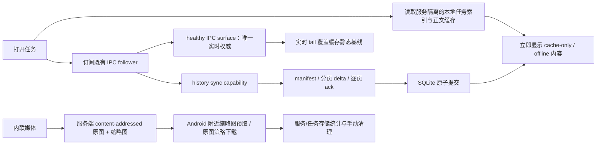

# Android Codex 历史缓存、媒体分层与卡死修复计划

## 1. 文档状态

- 状态：implementation-ready plan，尚未开始代码实施。
- 所属任务：`20260727-002 Codex 单权威路由与 TermLink Owner 控制面修复`。
- 事故窗口：2026-08-03 12:00–13:00（Asia/Shanghai）。
- 目标客户端：Android 原生 Codex 页面。
- 目标服务：同一手机上的多个独立服务配置，例如 `home`（域名 + mTLS）和 `local`（WireGuard + IP/port）。
- 上位约束：`docs/workflow/CONTRACTS.md` 的“Codex 原生会话实时同步核心”和 `docs/workflow/DECISIONS.md` 的 `AD-004`。
- 与旧计划的关系：本文件收敛并替代
  `codex-surface-memory-history-cache-implementation-plan.md` 中尚未真正接通的 Android 历史缓存、
  history sync 和媒体缓存部分；旧文档的既有内存/背压分析继续作为参考，不作为本轮直接执行清单。

## 2. 已确认问题与根因

### 2.1 事故不是 mTLS 或 WireGuard 本身造成

- `home` 和 `local` 使用不同网络路径，但在打开同一类大历史任务后出现相同卡死表现。
- 对目标 PC 的独立远程连接顺畅，服务端 `thread/list`、`thread/read`、`thread/resume` RPC 本身也能较快完成。
- 用户主动重启 App 是等待无反馈后的恢复动作，不是最初故障原因。

### 2.2 直接触发点是完整历史和内联媒体进入单个响应

- 复现任务 `019fbba5-2e2a-7323-862c-b673d23e33a6` 的 rollout 约 67.2 MiB，包含 31 个 turn 和多个
  `data:image/*;base64,...`，单条记录最大约 3.47 MiB。
- Gateway 在 `thread/read(includeTurns=true)` 完成后直接执行 `JSON.stringify` + `ws.send`，没有为历史响应做
  分页、单项上限、端到端 ack 或选择代次检查。
- Android 在收到完整字符串后一次性 `JSONObject(text)`，随后解析完整 turns；历史消息与实时控制消息共用
  `SharedFlow(extraBufferCapacity=64, DROP_OLDEST)`，大响应会占用解析、内存和 UI 状态处理时间，并可能静默丢弃事件。
- 服务端“RPC completed”日志发生在序列化和网络发送之前，因此不能证明响应已经被手机安全接收和应用。

### 2.3 任务切换还有独立的 stale in-flight 缺陷

- 日志中出现：已恢复一个较小或全新任务后，旧大任务的 `thread/read` 仍迟到并进入客户端。
- 当前 Android 只在大 JSON 已经解析后才依据 conversation id 拒绝 stale 响应；此时卡顿和内存成本已经发生。
- 重启不会“继续上一进程未完成的加载”，但新进程会恢复服务绑定的最后任务；本地缓存为空时又发起完整读取，
  所以用户看到的是同一问题在每次冷启动中重新发生。

### 2.4 已有缓存骨架没有形成闭环

- 真机 `codex_conversations.db` 中 `conversations/items/sync_* /attachments` 均为 0。
- 服务端在 root 不一致时发送 `conversation_history_manifest_required`，Android 已有 manifest page builder，
  但 ViewModel 没有处理该 required 消息，首次空缓存同步必然停在等待 manifest，最后超时。
- `thread/resume` 切换时 Android 会清空旧投影，却不会先读取目标任务缓存；5 秒后仍可能进入完整
  `thread/read(includeTurns=true)` 恢复。
- 任务历史列表只存在于 UI 内存，未持久化；正文缓存即使接通，也不能解决离线或冷启动时列表空白。
- 现有 delta builder 对“单个 item 自身超过 256 KiB”的情况没有硬保证。

### 2.5 已有媒体骨架不完整

- 服务端已经能按 SHA-256 保存部分输入图片并提供 `/api/codex/media/:sha256`，但历史 canonicalization
  没有统一抽离 base64。
- 服务端媒体 metadata 只在内存中，服务重启后不会从磁盘重建，已存在文件可能无法再打开。
- Android `CodexMediaClient` 尚未接入 UI、mTLS/Basic 认证、下载进度、缩略图或附件引用表。
- SQLite `attachments` 表没有 endpoint/conversation 归属，无法正确显示或清理 home/local 和单任务占用。

## 3. 本轮目标

1. 冷启动、断网或服务暂时不可用时，先显示当前服务已缓存的任务列表和任务正文。
2. 网络可用时只同步差异；首次同步也必须分页、可取消、可观察，不能把完整历史作为一个 WebSocket 响应发送。
3. 切换 A→B→A 时，旧任务的读取、分页、媒体下载和异步 UI 写回都不能影响新选择。
4. 历史中的内联图片必须变成稳定媒体描述符；列表附近自动预取缩略图，原图按产品策略下载。
5. 手机缓存不设置总空间上限、不自动淘汰，离线正文和已下载附件全部保留，直到用户手动清理。
6. 设置页提供存储管理入口，可按服务和任务查看正文/缩略图/原图占用并清理。
7. 所有等待都有明确阶段、进度、失败原因和重试入口，不再长期显示无解释的 loading。

## 4. 已确认产品策略

### 4.1 缓存总量与清理

- 不设置手机 Codex 缓存总量上限。
- 不做 LRU、按时间、按空间或后台自动淘汰。
- 每个附件仍保留单文件安全上限；现有服务端 25 MiB/文件限制不是“手机缓存总量上限”，继续保留。
- 设置页新增“Codex 存储管理”，按服务和任务显示占用并允许手动清理。

### 4.2 缩略图

- 自动预取当前屏幕附近的缩略图。
- 默认窗口：当前可见项前后各 5 条；快速滚动时取消离开窗口且尚未开始写盘的请求。
- 缩略图可在任意网络自动下载；它必须是受限的小文件，不能以原图冒充缩略图。

### 4.3 原图网络策略

- 配置项定义为“仅在 Wi‑Fi 下自动下载原图”，默认关闭。
- 默认关闭的语义：不在后台自动预取原图；用户明确点击查看原图时，可以在当前网络下载并显示进度。
- 开启后：只有已验证为 Wi‑Fi 的网络才会对屏幕附近图片自动预取原图；移动网络仍只取缩略图。
- 用户明确点击是主动请求，不受“自动下载”开关限制；若希望阻止移动网络主动下载，应另立产品选项，
  不在本轮把两个语义混为一谈。

### 4.4 离线保留

- 已同步的历史正文全部保留。
- 已下载的缩略图和原图全部保留。
- 服务配置删除后不自动删除缓存；存储页以“已删除服务”显示其孤立缓存，仍由用户手动清理。

## 5. 绝对不能改变的核心功能

以下链路是冻结区，本轮只能在它们外围添加兼容适配，不能重构、替换或降级：

```text
active conversation
  -> gateway follower acquire
  -> CodexIpcFeed desired subscription / reconnect replay
  -> Codex host targeted snapshot / patch
  -> Android IPC authority
```

- healthy IPC surface 继续是正文实时增量、operation、当前 turn 和运行态的唯一权威。
- canonical `thread/read` 只允许在明确 offline、desynced 或当前订阅周期缺少目标 surface 时作为有界恢复来源。
- 历史缓存、任务索引、manifest/delta、缩略图和媒体文件永远不是 live authority。
- 不删除或绕过 follower acquire/release、desired subscription、reconnect replay、normalized surface、
  owner fallback、canonical id/binding、Android authority 或 A/B 隔离。
- canonical conversation id 只接受 `thread/start`、`thread/resume`、`thread/fork` 的真实返回值。
- 不以 cwd、标题、latest task、时间戳、`codex_state=idle` 或快照静默时长猜任务或改权威。
- 不改变 Approval、Plan、Goal、interrupt、steer、compact、权限配置和 Owner/follower 控制路由。
- 不修改 Desktop/VS Code、上游 Codex、rollout 文件、Nginx mTLS/WireGuard 配置或 session 持久化。

## 6. 目标架构



关键分层：

- 任务索引：轻量、持久、可离线，解决“列表也加载不了”。
- 历史正文：完整逻辑历史的 cache-first 快照和差量，不保存原始 `thread/read` envelope。
- 实时 surface：只保存并显示当前任务的 live tail/运行态，继续服从 IPC authority。
- 媒体：二进制从正文和控制信道移出，正文只保存稳定描述符。

## 7. 明确修改范围

### 7.1 服务端现有文件

| 文件 | 修改内容 |
|---|---|
| `src/ws/terminalGateway.js` | 只增加 history/media 兼容适配：selection generation、取消、compact resume、history recovery 入口、进度转发和出站媒体描述符；不得改 authority router。 |
| `src/services/codexHistoryCanonicalizer.js` | canonical payload 去 transport 噪音，抽离 data URL/附件，产生稳定 media descriptor；保证相同逻辑历史得到稳定 hash。 |
| `src/services/codexHistorySyncService.js` | 补全 manifest 状态机、逐页 ack、单 envelope 字节硬上限、payload 分片、进度、取消和 stale generation 拒绝。 |
| `src/services/codexMediaStore.js` | 磁盘 metadata 重建、原图/缩略图双变体、原子写、尺寸/像素/格式校验、并发去重。 |
| `src/routes/codexMedia.js` | 保留原图路由，增加缩略图路由、ETag/Content-Length、明确 404/unsupported；继续使用现有认证中间件。 |
| `src/server.js` | 在 listen 前等待媒体 store 初始化；注入 history baseline/media projector。 |

### 7.2 服务端新增文件

| 文件 | 职责 |
|---|---|
| `src/services/codexHistoryBaselineProvider.js` | 从完整 Owner history、分页 thread API 或有界内部 `thread/read` 构造 baseline；raw 结果不发给 Android。 |
| `src/services/codexMobileSurfaceProjector.js` | 仅对发往 Android 的 clone 抽离媒体；不修改 Owner raw surface、IPC payload 或控制面状态。 |

### 7.3 Node 依赖与锁文件

- `package.json`、`package-lock.json` 仅为加入并锁定 `sharp@0.34.x` 修改。
- 保留 Node 18 主线；`sharp@0.35` 已不支持 Node 18，不得无意升级到该主版本。
- `sharp@0.34.x` 需要 Node `^18.17.0` 或更高，因此实施前必须验证所有正式服务宿主；若项目仍承诺
  Node 18.0–18.16，必须先明确把 `engines.node` 收紧到 `>=18.17.0` 的兼容影响。
- Windows x64、Linux x64 glibc/musl 的 optional dependencies 和 release 安装必须分别验证；任何一端缺二进制时，
  shipment gate 失败，不能静默改成把原图当缩略图。

### 7.4 Android 现有文件

| 文件 | 修改内容 |
|---|---|
| `codex/data/CodexConversationCacheStore.kt` | SQLite v1→v2 additive migration、任务索引、服务 metadata、媒体引用、统计/清理、manifest、原子 delta 和失败恢复。 |
| `codex/data/CodexHistoryCacheModels.kt` | cache/index/progress/media/storage DTO。 |
| `codex/data/CodexWireModels.kt` | manifest-required、page ack、进度、payload chunk/media descriptor、compact response capability 的 additive wire。 |
| `codex/network/CodexWebSocketClient.kt` | history/control 可靠信道；禁止对 history page 使用 `DROP_OLDEST`。 |
| `codex/network/CodexMediaClient.kt` | profile-aware Basic/mTLS HTTP、缩略图/原图变体、流式进度、hash/长度校验、取消和原子落盘。 |
| `codex/CodexViewModel.kt` | cache-first hydration、任务索引写回、manifest 回应、selection generation、同步/媒体 job 取消、cache/live 仲裁和进度。 |
| `codex/domain/CodexModels.kt` | UI progress、cache freshness、media descriptor/download state、任务索引来源字段。 |
| `codex/ui/CodexScreen.kt` | 同步状态、缩略图、原图加载进度/重试、附近预取窗口；保留现有消息、Goal/Plan/Approval UI。 |
| `CodexActivity.kt` | 只做图片查看/系统打开的最小 wiring；不改 Activity lifecycle、selection 或 IPC。 |
| `util/UiPreferences.kt` | `auto_download_originals_wifi_only=false`。 |
| `ui/settings/SettingsFragment.kt` | 存储管理入口和原图自动下载开关。 |
| `SettingsActivity.kt` | 只承接设置入口回调；不改服务 profile 保存/认证生命周期。 |
| `res/layout/fragment_settings.xml` | 新增存储管理行与 Wi‑Fi 自动下载开关。 |
| `res/values*/strings.xml` | 双语状态、错误、存储统计和确认文案。 |
| `AndroidManifest.xml` | 注册存储管理 Activity；增加 `ACCESS_NETWORK_STATE` 用于判断自动下载是否为 Wi‑Fi。 |

### 7.5 Android 新增文件

| 文件 | 职责 |
|---|---|
| `codex/storage/CodexCacheStorageRepository.kt` | 聚合 SQLite 与媒体目录统计，按 service/task 清理并做引用计数回收。 |
| `codex/storage/CodexStorageModels.kt` | 服务/任务占用、正文/缩略图/原图/共享字节模型。 |
| `ui/settings/CodexStorageManagementActivity.kt` | 独立存储管理页面，使用现有 Compose/Material3，不引入 RecyclerView 或新 UI 框架。 |
| `codex/network/CodexNetworkPolicy.kt` | 纯函数化网络策略：缩略图、用户主动原图、Wi‑Fi 自动原图。 |

### 7.6 测试文件

- 扩展：`tests/codexHistoryCanonicalizer.test.js`、`tests/codexHistorySyncService.test.js`、
  `tests/codexMediaStore.test.js`、`tests/terminalGateway.codexIpc.test.js`。
- 新增：`tests/codexHistoryBaselineProvider.test.js`、`tests/codexMobileSurfaceProjector.test.js`。
- 扩展 Android JVM：`CodexHistoryPageHashTest.kt`、`CodexViewModelThreadReadyTest.kt`、
  `CodexScreenHistoryScrollTest.kt`、`UiPreferences*Test.kt`。
- 新增 Android instrumentation：`CodexConversationCacheStoreTest.kt`、`CodexMediaClientTest.kt`、
  `CodexStorageManagementActivityTest.kt`。
- 所有 Android 编译、JVM test 和 APK 构建固定使用 JDK 21。

## 8. 详细实现方式

### 8.1 先阻断旧大响应路径

1. Android 对 `thread/resume` 发送 additive `responseProjection=metadata`。
2. Gateway 仍执行合法的 canonical resume/binding，但返回 Android 前只保留 id、title/name、cwd、状态、
   settings、token usage 等小型 metadata；不携带 turns/messages/data URL。
3. Android 不再自动请求通用 `thread/read(includeTurns=true)` 来填充正文。
4. 需要 canonical recovery 时发送专用 `conversation_history_recovery_request`；Gateway 可在服务内部调用
   `thread/read`，但必须先 externalize/canonicalize，再走 history page，raw 对象绝不进入 WebSocket。
5. 旧客户端的通用 `codex_request(thread/read)` 保持兼容；新 Android 不再使用该路径。服务端不得全局篡改
   Web/Desktop 调用语义。

### 8.2 selection generation 与取消

- 每次 active conversation 变化生成单调递增 `selectionGeneration`。
- history sync、manifest、page、compact resume、媒体请求都携带 `{endpointId, conversationId, generation}`。
- Gateway 在序列化前、排队前和实际 `ws.send` 前各校验一次 active conversation + generation。
- Android 在开始 IO、写 DB 后、提交 UI 前各校验一次 generation。
- 切换任务时立即：取消旧 history state、取消旧 media jobs、清理旧 staging、拒绝旧 ack/UI writeback；
  不删除旧任务已提交缓存。
- 上游 RPC 无法物理取消时允许其后台结束，但结果只能被丢弃，不能 stringify、发送或改变当前任务。

### 8.3 任务列表持久索引

新增 `thread_index`，主键为 `(endpoint_id, conversation_id)`，字段至少包括：

- `title`、`preview`、`archived`、`cwd`、`created_at`、`last_active_at`；
- `last_seen_at`、`last_remote_refresh_at`、`source`；
- `goal_objective` 仅保存服务端真实字段，不从普通文本猜测。

行为：

1. 打开历史面板时先在 IO 线程读取当前 profile 的 index 并显示。
2. 同时独立发送轻量 `thread/list`；成功后按当前 profile 原子 upsert，并按服务端明确的完整/分页语义决定是否删除缺失项。
3. 网络失败时保留列表并显示“离线缓存/上次更新”。
4. 正文同步不能阻塞 `thread/list` 控制信道。
5. 普通读取禁止使用 `readConversationByConversationId` 跨 profile 回退；home/local 即使 thread id 相同也不能串缓存。

### 8.4 正文 cache-first 与 manifest 闭环

打开任务的顺序固定为：

1. 精确读取 `(profile.id, conversationId)` 缓存。
2. 有缓存立即显示，状态为 `cache_only`；无缓存显示空骨架但不阻塞任务列表和其他任务切换。
3. 继续既有 follower subscribe；healthy surface 到达后，它只覆盖 live tail/运行态。
4. history capability 可用时发送 checkpoint。
5. 收到 `conversation_history_manifest_required` 后，Android 按服务端给定 page size 发送全部
   `{itemKey, contentHash}` 页；空缓存也必须发送 `pageIndex=0,lastPage=true,items=[]`。
6. 服务端计算差异并逐页发送；Android 每页校验、落 staging、回 page ack，服务端收到 ack 才发下一页。
7. 最后一页完整、hash/root/order 全部成立后，一次事务替换 canonical rows；然后发 final ack。
8. 任意中断只丢弃 staging，已提交缓存保持可读。

### 8.5 字节硬上限与大文本分片

- history JSON envelope 的硬上限为 256 KiB，按最终 `JSON.stringify` 的 UTF-8 字节数验证，不按字符数估计。
- media data URL 在分页前必须已抽离；发现任何 `data:*;base64` 仍在 payload 时直接 fail closed：
  `history_media_not_externalized`。
- 单个逻辑 item 超过 inline 上限时使用 capability-gated payload chunks：
  - page 中保留 item metadata、`payloadHash`、`payloadBytes`、`payloadChunkCount`；
  - 后续 chunk 每个最终 envelope 不超过 128 KiB；
  - Android 写入 `sync_payload_chunks`，集齐后按 UTF-8 重组并校验 hash；
  - 未集齐绝不提交 item，旧客户端不会收到此 v2 分支。
- 不允许“因为只有一个 item”而越过 256 KiB 上限。

### 8.6 baseline 来源

优先级：

1. TermLink Owner 已持有且明确 `historyBaselineComplete=true` 的完整历史。
2. Codex 已提供的分页 history/turn API，逐页 canonicalize。
3. legacy/unknown 任务在服务端内部做一次有界 `thread/read(includeTurns=true)`，只用于构造 baseline；
   raw 结果不出服务端进程。
4. 只有部分 surface 时标记 `partial`：只 upsert，不 delete，不声明全量 order，不覆盖手机已有更早历史。

baseline provider 必须按 `sourceEpoch + generation` 发布；较旧异步构造完成后不得覆盖新 source。

### 8.7 媒体 externalization

canonical payload 和发往 Android 的 normalized surface 使用同一种 media descriptor：

```json
{
  "kind": "image",
  "contentHash": "<sha256>",
  "mimeType": "image/png",
  "byteSize": 123456,
  "width": 1200,
  "height": 800,
  "originalPath": "/api/codex/media/<sha256>",
  "thumbnailHash": "<sha256>",
  "thumbnailPath": "/api/codex/media/<sha256>/thumbnail",
  "thumbnailByteSize": 18342
}
```

- 原始 Owner/IPC payload 只读保留；Gateway 对 Android 出站 clone 做替换。
- 不重写 rollout，不伪造用户消息，不改变 item id、turn id 或 role。
- 同一原图按 hash 去重；缩略图也是内容寻址。
- 服务启动时扫描 `data/codex-media` 重建 metadata；文件名、扩展、实际 magic、大小不一致时隔离为损坏文件，
  不返回错误 MIME。

### 8.8 缩略图生成

- 使用锁定的 `sharp@0.34.x` CommonJS API。
- 安全参数：`failOn='warning'`、`limitInputPixels=67_108_864`、`pages=1`、不启用 unlimited。
- 自动按 EXIF orientation 旋转；长边 320 px、`fit=inside`、`withoutEnlargement=true`。
- 输出 WebP，默认 quality 72/effort 4；默认不保留 EXIF/XMP/IPTC 等 metadata。
- 输出仍超过 256 KiB 时依次降低 quality/尺寸；不能满足时标记 `thumbnail_unavailable`，UI 显示普通图片占位，
  不回退传原图。
- GIF/WebP 动图只取第一帧；SVG/HEIC/HEIF/TIFF 等不能安全/稳定处理的格式先只保留原图和占位，
  不把 thumbnail 失败等同于原图失败。
- 相同 contentHash 只允许一个生成任务，其余等待同一个 Promise；使用 `.tmp` + fsync + rename 原子发布。

### 8.9 Android 媒体缓存

- 目录按 endpoint 隔离：`cacheDir/codex-media/<endpointId>/thumbs|originals/`。
- 文件名使用内容 hash；先写 `.part`，校验 HTTP length、SHA-256、图片 decode 后 rename。
- HTTP client 必须复用 profile 的 Basic/mTLS 配置，不创建绕过证书或认证的裸客户端。
- 缩略图附近预取最多 3 个并发，原图最多 1 个并发；任务切换取消不再相关的排队任务。
- 原图点击显示 determinate bytes progress；无 Content-Length 时显示已下载字节的 indeterminate progress。
- 下载失败保留缩略图和历史正文，提供单项重试，不把整个任务同步标记失败。

### 8.10 Android UI 仲裁

显示状态至少包括：

- `cache_only`：已显示本地缓存，等待服务。
- `syncing_manifest`：正在比对本地历史。
- `syncing_pages`：`已接收页/总页、items、bytes`。
- `live`：静态历史已同步，实时 tail 由 healthy IPC 接管。
- `partial`：服务端只有部分 baseline，手机旧历史保留。
- `offline`：展示完整已缓存内容。
- `failed`：显示 detail code、缓存仍可读、提供重试。

仲裁规则：

- cache 负责已经提交的静态历史和离线首屏。
- healthy IPC surface 负责当前 live turn、streaming text、operation、pending action 和 runtime。
- cache/delta 到达时只更新静态基线；若目标已有 healthy live authority，不得整体替换 `messages`。
- UI 不因正在同步 A 而禁止用户选择 B；任务列表和设置页保持可交互。

### 8.11 Android SQLite v2

采用 additive migration，不删除 v1 表：

- 新增 `services`：服务显示名、脱敏 origin、最后观察时间、是否仍存在 profile。
- 新增 `thread_index`：任务列表缓存。
- 新增 `media_blobs`：endpoint + hash + variant + path + physical bytes + state。
- 新增 `conversation_media_refs`：endpoint + conversation + item + original/thumbnail hash。
- 新增 `sync_payload_chunks`：大 item 临时分片。
- `conversations/items/sync_*` 继续使用，但补齐 schema/version/progress/expiry 迁移所需列或旁表。
- v1 `attachments` 保留为 legacy 兼容表；有明确 endpoint/conversation 归属时 on-touch 迁移，不能猜归属。

升级约束：

- `onUpgrade(1,2)` 只执行 CREATE/ALTER/索引，不 DROP、不清库。
- migration 失败时关闭写入并继续尝试读取 v1 已有数据；禁止自动重建空库。
- 首次 v2 canonical payload 会导致 root 改变并执行一次受控全量差异同步，这是预期兼容成本。

### 8.12 存储统计与手动清理

存储页两级展示：

1. 服务级：服务名、脱敏地址、任务数、正文、缩略图、原图、总可归属字节。
2. 任务级：标题、最后活动时间、正文、缩略图、原图、可回收字节、共享媒体提示。

统计口径：

- 正文按 `payload_bytes` 求和。
- 媒体按磁盘实际文件长度；同一服务内跨任务共享的 blob 在服务总量中只计一次。
- 单任务显示逻辑引用字节和“若只清除此任务可实际回收”的字节，避免共享文件重复计入可回收量。
- SQLite page/WAL 固定开销显示为“数据库开销”；清理后执行受控 checkpoint，必要时在无 active transaction 时 VACUUM，
  并显示清理前后实际 App 存储差值。

清理语义：

- 清理任务：取消该任务 sync/download，删除 canonical history/index/media refs；仅删除无其他引用的媒体文件。
- 清理服务：清理该 endpoint 的全部任务和媒体，但不删除 server profile、Basic/mTLS 凭据、远端任务或 rollout。
- “清理所有”必须二次确认并列出范围。
- 未发送 composer 草稿、当前 pending intent、凭据和设置永远不属于缓存清理目标。
- 清理当前正在显示的任务后，如果仍在线，显示空缓存并允许重新同步；不得自动删除远端数据。

### 8.13 无总量上限时的低磁盘处理

- 不因为空间紧张自动删除任何旧缓存。
- 遇到 `ENOSPC`/SQLite full：终止当前新写入，回滚 staging/`.part`，保留既有缓存，明确显示“设备空间不足”。
- 实时 IPC 仍可继续显示内存中的当前 turn；不能把写盘失败误判为服务离线或 authority 变化。
- 用户可进入存储管理手动清理后重试。

## 9. 协议扩展

全部为 capability-gated additive fields/events：

- client request：`cacheSchemaVersion=2`、`selectionGeneration`、`responseProjection=metadata`。
- server capability：`historySync.features=[manifest,perPageAck,payloadChunks,progress,mediaDescriptors]`、
  `codexMedia.thumbnail=true`。
- `conversation_history_manifest_required`：Android 必须处理。
- `conversation_history_page_ack`：每页持久化后发送。
- `conversation_history_progress`：phase/pages/items/bytes。
- `conversation_history_recovery_request`：服务内构造 canonical baseline，不返回 raw thread。
- 现有 `conversation_history_sync_ack` 保留为最终 root commit ack。

旧客户端忽略新 capability/事件；新 Android 连接只支持 v1 的旧服务端时：

- 可以继续读取已有本地缓存和 live IPC surface；
- 不得自动回退为无限制 `thread/read(includeTurns=true)`；
- 显示“服务端不支持安全历史同步”，允许用户继续实时会话或升级服务端。

这是有意的安全兼容取舍：宁可明确缺少旧历史，也不能重新引入无上限大响应卡死。

## 10. 分阶段实施与门禁

### Phase A：传输止血和 stale 隔离

- 补 manifest-required handler、selection generation、取消和 metadata-only resume。
- 新 Android 停止 raw full `thread/read`。
- 门禁：合成 70 MiB/多 base64 fixture 时，Android 收到的最大 WebSocket envelope ≤256 KiB；切换后旧任务零出站。

### Phase B：任务索引和正文 cache-first

- SQLite v2、thread index、manifest/delta/page ack、cache/live 仲裁。
- 门禁：冷启动和离线能看到全部已缓存列表/正文；首次空库同步可完成；中断只丢 staging。

### Phase C：媒体 externalization 和缩略图

- 服务端原图/缩略图、metadata rebuild、Android 认证下载与附近预取。
- 门禁：历史/实时 mobile envelope 中不存在 data URL；home mTLS 和 local 均能打开缩略图/原图。

### Phase D：设置和存储管理

- Wi‑Fi 自动原图选项、服务/任务统计和手动清理。
- 门禁：默认不自动取原图；开启后仅 Wi‑Fi 自动取；清理不会影响其他服务、共享媒体、凭据或远端任务。

### Phase E：性能、兼容和真机验收

- 回归冻结 IPC/Owner 链、压力/重启/A→B→A、双服务、低磁盘和升级迁移。
- 每个 Phase 单独 review/commit/checkpoint；前一阶段未达到退出条件，不进入下一阶段。

## 11. 自动化验证

### 11.1 Node

- canonicalization：等价输入稳定 hash；transport 字段不影响；data URL 全部变 descriptor；不改 item/turn/role。
- sync：空 manifest、分页 manifest、逐页 ack、重复页、乱序页、断线、stale generation、单 item chunk、
  最终 envelope 字节上限、backpressure timeout。
- baseline：complete/partial/paginated/legacy、sourceEpoch 竞态、旧结果不覆盖新 baseline。
- media：重启扫描、内容去重、缩略图参数、损坏文件、超像素、动画首帧、并发去重、原子写、ETag。
- gateway：metadata-only resume、内部 read 不出站 raw、列表不被历史阻塞、A→B 切换后 A 无 send。
- 固定重跑冻结链：IPC client/feed/Owner/Gateway 既有 targeted suites 和 TD-004 confirmed narrow gate。

### 11.2 Android JVM/instrumentation

- SQLite 1→2 非破坏迁移、首次空库 manifest、原子 commit、staging 恢复、跨 endpoint 隔离。
- task index cache-first、remote upsert、offline retain、deleted profile orphan display。
- generation：切换前/DB 写后/UI commit 前的 stale 拒绝。
- reliable history channel：页面不会因 buffer 满而静默 DROP_OLDEST。
- media：Basic、mTLS、hash/length、`.part`、取消、重试、缩略图窗口、并发限制。
- network policy：默认 false；thumbnail any network；auto original Wi‑Fi only；explicit original any network。
- storage：服务/任务统计、共享引用、任务清理、服务清理、active task 清理、失败回滚。
- UI：cache/offline/progress/partial/failed、原图 progress、无无限 loading、历史滚动状态不回归。

## 12. 真机验收矩阵

使用已连接测试机 `da34332c`，实现阶段按项目 `adb-real-device-debug` 流程执行：

1. `home`（域名 + mTLS）冷启动：缓存列表和正文立即出现，后台差异同步完成。
2. `local`（WireGuard + IP/port）重复同样流程；WireGuard 未连接时明确显示 offline cache，不归因为 App 卡死。
3. 打开 67.2 MiB 事故任务或等价合成任务，观察无 ANR/OOM、无数十 MiB WebSocket frame。
4. A 大任务同步中切 B 小任务，再切 A；B 不受 A 迟到响应影响，A 从已提交 checkpoint 继续。
5. 同步/缩略图/原图下载中强制结束并重开；`.part`/staging 不污染，已提交缓存可读。
6. 任务历史 `thread/list` 失败时仍能切换本地缓存任务。
7. 缩略图随滚动附近预取；默认不后台下载原图；开启选项后仅 Wi‑Fi 自动下载原图。
8. 原图主动打开显示进度，home mTLS 和 local 均成功。
9. 存储管理按任务清理不影响同服务其他任务；按 home 清理不影响 local；共享媒体引用正确。
10. 断网完整浏览全部已缓存正文和已下载附件。
11. 保持 Desktop/VS Code 各做一次普通消息、running stream、interrupt、Approval/Plan/Goal 基础 smoke，
    证明 history/cache/media 适配没有改变 frozen authority。

## 13. 性能和可观察性验收

- history WebSocket envelope：≤256 KiB；payload chunk envelope：≤128 KiB。
- history page：最多一个未 ack 的 in-flight page。
- Android 主线程：不执行 SQLite、文件 hash、图片 decode 或完整 history JSON 解析。
- 首屏：有缓存时不等待网络；状态和列表 500 ms 内进入可交互目标，最终以真机 trace 为准。
- 所有同步日志只记录 endpoint/conversation 短 hash、generation、page/items/bytes/phase/duration/detailCode；
  不记录正文、命令、路径、URL 查询、base64、附件内容、凭据或证书。
- 服务端补充 `rpcCompletedAt/serializedBytes/sendQueuedAt/sendCompletedAt`，避免再把 RPC 完成误认成客户端完成。

## 14. 对现有功能的影响

### 正向变化

- 冷启动和离线可直接使用任务列表/历史正文。
- 大历史不再阻塞列表、任务切换和实时控制消息。
- 图片首屏只加载缩略图，原图有明确进度。
- 用户可以看到并手动管理每个服务/任务占用。

### 成本与兼容影响

- 手机存储会持续增长，因为产品明确不设总量上限且不自动淘汰。
- 首次升级会执行 SQLite additive migration；canonical schema 变化会触发一次受控重新同步。
- 服务端增加媒体磁盘、缩略图 CPU 和 `sharp` native dependency；Windows/Linux release 都必须验证。
- 新 Android 对不支持安全 history sync 的旧服务端不再自动做无限制 full read，可能只能看到本地缓存 + live 内容，
  但会给出明确升级提示。
- 缓存首屏可能短暂显示上次同步的静态正文；UI 必须标记 cache 状态，healthy live surface 到达后按冻结规则接管实时 tail。

### 不受影响

- mTLS、Basic、WireGuard、Nginx 路由和 WebSocket upgrade 配置。
- Desktop/VS Code 的原生任务、rollout、IPC Owner/follower 协议。
- Android 发送、Approval、Plan、Goal、interrupt、权限、模型和 canonical binding。
- 服务端远端任务的创建、归档、删除和会话持久化。

## 15. 特别注意事项

1. “完整缓存”指完整 canonical 逻辑历史，不是缓存原始 `thread/read` JSON。
2. 不能为了 cache-first 把 cache 变成 live authority；这是本计划最重要的架构门禁。
3. `readConversationByConversationId` 的跨 profile fallback 不能用于普通恢复，否则 home/local 会串线。
4. stale 检查必须发生在服务端 stringify/send 前和 Android UI commit 前，仅在最终 reducer 检查不够。
5. 媒体描述符必须参与 canonical hash；服务器重启后的 metadata rebuild 必须稳定，否则会反复全量同步。
6. 缩略图失败不能回退为自动下载原图。
7. 无空间时必须 fail closed，不能通过自动删除旧缓存“自愈”。
8. 清理操作只能影响手机本地缓存，不能调用远端 thread delete/archive。
9. Settings 统计和清理必须在后台线程运行；大库 `VACUUM` 显示进度且不能阻塞 Codex 页面实时链。
10. `sharp` 版本、Node 最低版本和跨平台 optional dependency 是 shipment gate，不是可忽略的安装细节。

## 16. 回滚策略

- Wire/projection 均由 capability 开关控制；可逐阶段关闭 history v2、thumbnail 或 auto-original，不影响 IPC realtime。
- SQLite v2 只新增表/列，旧版本 App 可忽略；禁止用 downgrade 删除 v2 数据。
- Phase A 可单独回滚 Android v2 请求，仍保留已有本地缓存；但不得恢复自动无限制 full read 作为默认路径。
- Phase C 可关闭缩略图 capability，历史正文仍使用 descriptor + 占位，不回退 base64。
- 清理/迁移前使用事务和原子文件；失败后保留旧 committed root 与已下载媒体。
- 任何阶段若触及冻结 authority 行为，立即停止，不以回滚缓存数据代替架构审查。

## 17. 完成定义

只有同时满足以下条件才能宣布修复完成：

- 事故级大任务不再产生超限 WebSocket frame、ANR、OOM 或无提示卡死。
- 首次空缓存、已有缓存、离线、重启、中断和 A→B→A 全部通过。
- home mTLS 与 local WireGuard 两条路径均通过同一功能矩阵。
- 任务列表和正文都能 cache-first；manifest-required 闭环真实工作，数据库不再保持空表。
- 历史和 mobile live surface 不含 data URL；缩略图/原图/进度/网络策略符合已确认产品决策。
- 存储管理能准确按服务/任务展示并安全清理，且没有任何自动淘汰。
- frozen IPC/Owner/canonical/Approval/Plan/Goal 回归全部通过。
- 专项 Node/Android 自动化、JDK 21 APK、真机日志和截图证据已写回 `CURRENT_TASK.md`。
