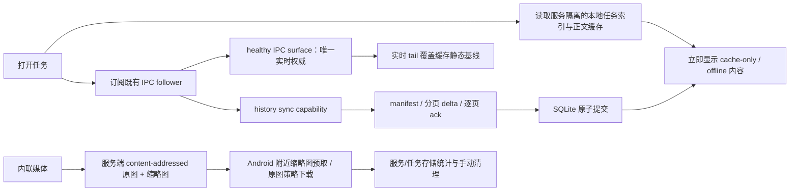

# Android Codex 历史缓存、媒体分层与卡死修复计划

## 1. 文档状态

- 状态：15a–15f 实现与自动化记录完成；15g 实现已完成，最终 home/local、离线、重启、A→B→A、媒体和清理矩阵
  交由用户手动验收；15h 等待手动结果回写。WireGuard 不纳入验收矩阵，local 只按同一局域网 IP/port 验收，home
  以域名+mTLS 作为认证层对照。此前的设备/fixture 记录仅作实施期辅助证据，不能替代用户手动结论；agent 不再
  继续执行真机、网络或生产数据操作。
  本文件既是实施基线，也是当前实现
  与剩余验收项的单独修复计划。新 APK 已补做冷启动、强制结束、
  A→B→A、LAN 断网 cache-first、home mTLS/local LAN 会话列表、缩略图落盘和存储统计验证；不把 WireGuard
  作为本轮独立必测门禁。WireGuard 与域名+Nginx 都属于可能受限或抖动的网络路径变量；当前局域网测试以
  local IP/port 直连验证功能，以 home 域名+mTLS 对照认证层。之前短暂启用 `wgs_client` 的在线结果仅作
  诊断记录，不改变本轮验收范围。上述内容不是用户最终手动验收结论。
- 事故大任务的 `complete=0` 当前有明确语义：其 live IPC surface 仍报告 `status=running`、
  `hasActiveGoal=true`，baseline provider 必须保留 partial，不能把运行中任务伪造为完整终态；但该状态
  不是本轮修复的阻塞条件。当前活动 Goal 就是本任务的执行载体，不需要等待它进入终态，也不通过中断、
  force-stop 或改写远端状态来制造 `complete=1`；缓存正文、root/item_count、bounded live surface 和错误门禁
  直接作为验收证据。
- 本批覆盖：Gateway 内部 baseline recovery、metadata-only thread/read/resume 投影、history selection
  generation、256 KiB UTF-8 envelope fail-closed、Android manifest-required/可靠 history channel、
  stale manifest/delta/ack 取消门禁、v2 逐页 ACK 与 capability-gated UTF-8 payload chunks（chunk
  envelope ≤128 KiB），SQLite v1→v3 additive migration、服务隔离 thread index、cache-first 任务列表/正文、
  content-addressed 媒体与缩略图、Android 网络策略/下载进度，以及按服务/任务手动存储管理。
- 当前实施期证据边界：`da34332c` 曾验证历史列表、live IPC 正文、A→B→A 选择、设置项、存储管理页和 v3 数据库迁移；
  另外已验证一次重启后的 bounded history manifest/delta/page-ack 闭环，以及新 APK 的强制结束后冷启动、
  bounded realtime tail 和同一 LAN 临时断 Wi‑Fi 的 cache-first 恢复。此前一次设备数据库只读快照确认两个真实
  缩略图文件和媒体引用已落盘；home 的小型已完成任务（`019fbe62-0068-77c1-81ac-b6e1d64dc968`、28 items，
  `complete=1`；`019fc5cf-3fcc-7ae3-9456-a4c0e292a054`、4 items，`complete=1`）提供了完整基线终态证据，
  事故大任务仍为 `complete=0`/partial，不能把它写成已完成。存储页显示 `local` 服务 50 个任务、历史正文
  10.8 MiB、缩略图 140 B、原图 0 B，并按任务列出占用和“清理”入口。使用正确的 `home` session ID 直接启动
  Codex 后，home mTLS/WSS 建连、IPC authoritative surface 与 bounded history recovery 均成功；会话抽屉触发的
  home mTLS 与 local LAN `/api/sessions` 也均返回 200。真实服务原图 smoke 已通过：
  `CodexMediaClientRealServiceInstrumentationTest` 在生产配置的 home 域名+mTLS 与 local LAN 两个 profile
  使用临时缓存完成同一 hash 的长度/hash 校验，进度均从 0 到完成，`.part` 均清理；生产缓存未改写。
  跨服务/共享媒体清理已经通过隔离存储层与隔离设置页 UI instrumentation，但没有对生产 home/local 缓存执行
  destructive 点击。局域网断网只用于验证通用 cache-first/offline 行为，网络路径差异不单独阻塞本轮。
- 最新清理与媒体证据：真实设备上的隔离 instrumentation 已通过任务/服务共享引用统计和路径返回断言
  （`CodexConversationCacheStoreMediaCleanupTest`：`OK (1 test)`），隔离设置页两个任务/服务清理用例也通过
  （`CodexStorageManagementActivityTest`：`OK (2 tests)`）。`CodexMediaClientInstrumentationTest` 现验证了
  原图 hash/长度校验、下载进度从 0 到完成、`.part` 临时文件清理、原子落盘以及缓存缩略图命中不再发起
  第二次请求（`OK (2 tests)`）。这些测试均使用
  注入的独立 SQLite 文件名和独立媒体目录，teardown 后确认测试资源消失，生产数据库、home/local 缩略图和
  正文缓存未被删除；真实设置页 destructive smoke 仍不会为了验收而清空用户缓存。
- 最新窄门复核：history/baseline/media/projector/route、Gateway、IPC、Owner 集合重新运行 167/167；
  `tests/terminalGateway.codexIpc.test.js` 文件级 69/69，JDK 21 `:app:testDebugUnitTest` 与 debug/test APK
  重建成功。Windows x64 Node 24.12.0 与 WSL Debian/Linux x64 Node 18.20.4 均在隔离安装目录成功加载
  `sharp@0.34.5`/libvips 8.17.3；`npm run android:check-release-config` 仍因仓库既有
  `cleartext=true`/`androidScheme=http` 正确失败，本轮未改发布配置。只读诊断副本未作为生产数据使用。
- 2026-08-04：补强媒体选择代次门禁：历史 delta/payload page 提交后会按时间尾部（初始可见区域）触发最多 6 个
  缩略图预取候选，实际并发限制为 3，临时失败可在同一代次重试；主动原图下载的进度、完成回调和清理状态均要求
  仍处于同一 conversation/selection generation，A→B 切换时旧下载不会覆盖 B 的进度或打开旧文件。该改动只作用于
  Android 本地媒体 UI/缓存，不改变 IPC surface authority。
- 2026-08-04：媒体门禁变更后的 debug APK 在 `da34332c` 再次冷启动；约 10 秒内恢复 home 会话并收敛到
  `IPC_AUTHORITATIVE`，未见 `FATAL EXCEPTION`、`OutOfMemory` 或缩略图预取异常。
- 2026-08-04：真机滚动检查发现带媒体的工具执行项原先被 command batch 折叠提前截断，附件入口不可见；`CodexScreen`
  现对含结构化媒体或 Markdown 图片的消息保留完整卡片，只有无附件批次继续折叠。JDK 21 JVM 与 debug APK
  重建安装成功；该修复只恢复媒体入口，不改变工具批次、实时 IPC 或控制语义。
- 2026-08-04：修复 history sync 的最终 ACK 收尾缺口。旧实现即使已发出 `partial/baseline_partial` 或 `live`，仍会
  保留 inactivity timer，约 30 秒后再次发送误导性的 `sync_timeout`；`handleAck()` 最后一页和 root/checkpoint
  命中快路径现在都会取消该 sync。新增“partial 最终 ACK 不得后续 timeout”测试，history/baseline/media/projector/route、
  Gateway、IPC、Owner 聚焦集合为 167/167。`da34332c` 当前 active profile 为 home（域名+mTLS），15:27 重试后
  真机日志出现 `history_unavailable → manifest_required → delta_applied=COMMITTED → sync_state=live`，等待超过
  原 30 秒窗口未出现新的 `sync_timeout`；旧日志中的 timeout 仍保留作修复前对照，不作为当前回归失败。
- 2026-08-04：媒体下载 job 的并发注册改用线程安全 map，避免 A→B 切换时旧 job 的 finally 清理误删 B
  任务新建的 job；该改动只收敛 Android 本地媒体生命周期，不改变 IPC surface authority。JDK 21 Android JVM、
  debug/test APK 均成功重建并覆盖安装；真机直接 runner 复跑媒体进度、共享引用清理和隔离存储 UI 三组用例，结果
  分别为 `OK (1 test)`、`OK (1 test)`、`OK (2 tests)`。设置页 UI 测试使用 debug-only 数据库注入 seam、debug
  manifest 的仅调试导出和 `UiAutomation` accessibility 操作隔离数据库；生产 manifest 仍保持
  `exported=false`，测试顺序/屏幕待机造成的假失败已收敛；生产缓存没有执行删除。
- 2026-08-04：最终真机 direct runner 合并复跑 5 tests 全部通过：本地 mock 原图进度/原子落盘 1、跨服务共享引用
  清理 1、设置页任务/服务清理 2、真实服务原图 smoke 1。真实 smoke 从生产数据库只读取得已有 original hash，
  在独立 cache 目录经 home 域名+mTLS 与 local LAN 下载并校验 SHA-256、长度、0→完成进度和 `.part` 清理；
  teardown 后未触碰生产 `files/codex-media` 或 `codex_conversations.db`。因此媒体原图路径门禁已关闭，剩余
  仅是事故大任务 `complete=0` 的完整基线终态观察，以及禁止为验收而执行的生产 destructive 清理。
- 2026-08-04：新增 `CodexMediaClientRealServiceInstrumentationTest`，在 `da34332c` 读取应用已保存的
  home 与 local profile 和只读媒体引用，分别经 `https://code.kongxn.com:442`（域名+mTLS）与
  `http://192.168.50.12:3010`（局域网 IP/port）下载真实原图。两端均 `OK (1 test)`，日志分别记录
  `bytes=68`、进度回调 `0→68`（2 次）、SHA-256/长度/图片解码通过，且 `.part` 不残留；下载写入独立
  instrumentation 临时目录并在 teardown 删除，生产正文、缩略图和 media_blobs 未改变。该证据关闭“真实
  服务 HTTP 原图链路”子项，但尚未等价于 UI 点击原图的视觉/进度验收，home 完整基线和 destructive smoke
  仍保持开放。
- 2026-08-04：实现复核补上主动原图完成后的同一 `selectionGeneration`/conversation 门禁，A→B 切换时
  旧下载不会把结果登记到当前 profile 的 `media_blobs`；JDK 21 Android JVM、debug instrumentation APK
  编译与 Node focused 167/167、Gateway 69/69 均通过。该修复只收敛旧任务异步写回，不改变缓存保留、媒体
  下载协议或 IPC authority。
- 2026-08-04：离线媒体回填补强：Android 在历史缓存解码后先校验 endpoint-isolated content-addressed
  thumbnail（以 descriptor 的 `thumbnailHash` 验证），命中即把本地路径回填到当前/缓存正文并登记 usage，
  不等待网络；本地文件缺失或校验失败才走受限缩略图预取。`CodexMediaClientInstrumentationTest` 新增
  “缓存缩略图不产生第二次网络请求”用例，最终 direct runner 合计 `OK (6 tests)`；生产正文、缩略图、原图
  和数据库未被测试清理。该修复只改善 cache-first/offline media UX，不改变 IPC authority、缓存无限保留或
  用户手动清理语义。
- 2026-08-04：最终 APK 覆盖安装后以正确 home 域名+mTLS session 冷启动，约 1 秒进入 `CodexActivity`；
  约 33 秒 PID 保持存活并持续报告 `IPC_AUTHORITATIVE`，无 `OutOfMemory`、`FATAL EXCEPTION`、
  `CODEX_ENVELOPE_TOO_LARGE` 或新的 `sync_timeout`。本次只读观测未发送消息、未中断 Goal、未执行生产清理，
  因此事故大任务仍按 `complete=0`/partial 记录。
- 2026-08-04：再次只读核对设备 v3 cache：home 事故任务的 `items` 已落库 2,804 条、local 同一任务
  1,960 条，说明 cache-first 正文持久化已覆盖当前已收到的历史；但 live IPC 仍是
  `status=running`/`hasActiveGoal=true`，`complete=0` 仍表示外部 Goal 未终态，不能以“缓存已满”代替
  完整基线终态，也未为验收中断或改写该任务。
- 2026-08-04：清理 Kotlin 增量缓存后，JDK 21 分阶段重建 `:app:assembleDebug` 与
  `:app:assembleDebugAndroidTest` 均成功；覆盖安装到 `da34332c` 后，媒体/缓存/共享引用/存储 UI/真实服务原图
  合并 instrumentation 稳定为 `OK (6 tests)`。组合首次运行的存储 UI 曾受 Activity 时序导致 `root=null`，单独
  `OK (2 tests)` 后重新唤醒屏幕并合并复跑通过；因此记录为测试时序观察，不把它误报为产品失败。新增
  `CodexScreenMediaProgressTest` 对未知总量省略号、匹配 hash 的 50%/100% 钳位、stale/missing hash 不展示
  进度做纯 JVM 覆盖；随后 JDK 21 `:app:testDebugUnitTest` 再次 `BUILD SUCCESSFUL`。冷启动日志继续只有
  `IPC_AUTHORITATIVE` surface，无 OOM/FATAL/超大 envelope/新
  `sync_timeout`；事故大任务仍因外部 Goal `running` 保持 `complete=0`，15g/15h 未提前关闭。
- 2026-08-04：受控真机滚动暴露出另一处 UI 合并缺口：健康 IPC 的 `itemsTruncated` 只携带实时尾部时，
  history delta/chunk 已写入 `cachedCanonicalMessages`，但 `messages` 仍可能只显示尾部，旧正文和媒体入口
  因而无法滚动到。新增 `mergeCachedHistoryIntoLiveMessagesForUi`，把当前选择的缓存正文作为静态基底，
  仅让同一 conversation 的 IPC live 条目覆盖同 ID/同用户内容，并在 A→B 时拒绝旧 surface 泄漏；冷启动、
  delta、idempotent delta 和 payload chunk 四个入口统一使用。`CodexViewModelThreadReadyTest` 89/89、
  `CodexScreenMediaProgressTest` 3/3 和 debug/test APK 构建通过；该 APK 已覆盖安装到 `da34332c`，后续冷启动
  仍保持 IPC authoritative。缓存滚动与 UI 原图点击属于可见性观察项，不再以活动 Goal 的终态作为执行前置条件。
- 2026-08-04：补齐冷启动/IPC 自动选中任务的 cache-first hydrate 竞态。自动发现任务时现在立即读取同一
  endpoint 的缓存；磁盘读取即使晚于 IPC snapshot，也统一通过“缓存正文基底 + 同 conversation healthy IPC
  覆盖”合并，避免 bounded live tail 把历史正文/媒体入口遮住。新增 cache-first selection JVM 用例；JDK 21
  `:app:testDebugUnitTest`、debug/test APK 构建与覆盖安装通过，未改变 IPC authority 或 A→B generation 门禁。
- 所属任务：`20260727-002 Codex 单权威路由与 TermLink Owner 控制面修复`。
- 事故窗口：2026-08-03 12:00–13:00（Asia/Shanghai）。
- 目标客户端：Android 原生 Codex 页面。
- 目标服务：同一手机上的多个独立服务配置，例如 `home`（域名 + mTLS）和 `local`（当前测试为局域网 IP/port；生产环境可经 WireGuard）。
- 上位约束：`docs/workflow/CONTRACTS.md` 的“Codex 原生会话实时同步核心”和 `docs/workflow/DECISIONS.md` 的 `AD-004`。
- 与旧计划的关系：本文件收敛并替代
  `codex-surface-memory-history-cache-implementation-plan.md` 中尚未真正接通的 Android 历史缓存、
  history sync 和媒体缓存部分；旧文档的既有内存/背压分析继续作为参考，不作为本轮直接执行清单。

## 2. 已确认问题与根因

### 2.1 事故不是 mTLS 或某一条网络路径本身造成

- `home` 和 `local` 使用不同网络路径，但在打开同一类大历史任务后出现相同卡死表现。
- 对目标 PC 的独立远程连接顺畅，服务端 `thread/list`、`thread/read`、`thread/resume` RPC 本身也能较快完成。
- 用户主动重启 App 是等待无反馈后的恢复动作，不是最初故障原因。
- 本轮不把 WireGuard 单独拆成故障复现条件：它与域名+Nginx 都只是传输稳定性/带宽限制变量；home 的 mTLS
  与 local 的无 mTLS 局域网直连构成认证层对照，足以验证“卡死不依赖 mTLS”。

### 2.2 直接触发点是完整历史和内联媒体进入单个响应

- 复现任务 `019fbba5-2e2a-7323-862c-b673d23e33a6` 的 rollout 约 67.2 MiB，包含 31 个 turn 和多个
  `data:image/*;base64,...`，单条记录最大约 3.47 MiB。
- Gateway 在 `thread/read(includeTurns=true)` 完成后直接执行 `JSON.stringify` + `ws.send`，没有为历史响应做
  分页、单项上限、端到端 ack 或选择代次检查。
- Android 在收到完整字符串后一次性 `JSONObject(text)`，随后解析完整 turns；历史消息与实时控制消息共用
  `SharedFlow(extraBufferCapacity=64, DROP_OLDEST)`，大响应会占用解析、内存和 UI 状态处理时间，并可能静默丢弃事件。
- 服务端“RPC completed”日志发生在序列化和网络发送之前，因此不能证明响应已经被手机安全接收和应用。

### 2.3 任务切换还有独立的 stale in-flight 缺陷

- 日志中出现：已恢复一个较小或全新任务后，旧大任务的 `thread/read` 仍迟到并进入客户端。
- 当前 Android 只在大 JSON 已经解析后才依据 conversation id 拒绝 stale 响应；此时卡顿和内存成本已经发生。
- 重启不会“继续上一进程未完成的加载”，但新进程会恢复服务绑定的最后任务；本地缓存为空时又发起完整读取，
  所以用户看到的是同一问题在每次冷启动中重新发生。

### 2.4 已有缓存骨架没有形成闭环

- 真机 `codex_conversations.db` 中 `conversations/items/sync_* /attachments` 均为 0。
- 服务端在 root 不一致时发送 `conversation_history_manifest_required`，Android 已有 manifest page builder，
  但 ViewModel 没有处理该 required 消息，首次空缓存同步必然停在等待 manifest，最后超时。
- `thread/resume` 切换时 Android 会清空旧投影，却不会先读取目标任务缓存；5 秒后仍可能进入完整
  `thread/read(includeTurns=true)` 恢复。
- 任务历史列表只存在于 UI 内存，未持久化；正文缓存即使接通，也不能解决离线或冷启动时列表空白。
- 现有 delta builder 对“单个 item 自身超过 256 KiB”的情况没有硬保证。

### 2.5 已有媒体骨架不完整

- 服务端已经能按 SHA-256 保存部分输入图片并提供 `/api/codex/media/:sha256`，但历史 canonicalization
  没有统一抽离 base64。
- 服务端媒体 metadata 只在内存中，服务重启后不会从磁盘重建，已存在文件可能无法再打开。
- Android `CodexMediaClient` 尚未接入 UI、mTLS/Basic 认证、下载进度、缩略图或附件引用表。
- SQLite `attachments` 表没有 endpoint/conversation 归属，无法正确显示或清理 home/local 和单任务占用。

### 2.6 本轮真机复现补充的服务端根因：异常 data URL 让基线投影失败

- IPC surface 中存在看似 `data:image/*;base64`、但实际不是可解码图片的字符串。媒体投影把它交给图片解码器后抛出
  `media_content_invalid`，导致 `baseline_projection_failed`，随后 history sync 只能落到
  `history_media_not_externalized`/不可用分支。
- 这不是 mTLS、WireGuard 或 WebSocket 连接失败；同一个 surface 在不含非法媒体时可以正常进入 manifest/delta 流程。
- 修复方式是 fail-closed：合法图片才写入 content-addressed media store；非法/不支持格式改为不可用图片描述符或占位文本，
  绝不把原始 data URL 发给 Android，也绝不让一张坏图片阻塞整段正文历史。

### 2.7 异步基线竞态与跨语言 page hash 不一致

- Gateway 的媒体投影是异步的；如果 history request 先于 projection 完成，客户端会收到一次假的
  `history_unavailable`。现在请求会等待当前 conversation 的投影 promise，并用 revision 丢弃较旧结果。
- Android 原先用 `JSONObject.quote` 计算 page hash，会把 `/` 写成 `\/`；Node `JSON.stringify` 不转义 `/`，因此包含 URL/path 的页全部被真机判为 hash mismatch，
  没有 page ACK。Android 已改为与 Node 相同的 UTF-8 JSON quoting，并增加 URL 斜杠 golden vector。

### 2.8 partial 状态下的重复同步循环

- `baselineComplete=false` 时每个 live surface snapshot 都会更新静态基线；Android 在收到 `partial` 后清空 in-flight 标记，
  又在下一次 snapshot 重新发 manifest，形成几秒一轮的重复分页/ACK。
- 现在 history sync 只在新选择、重连、恢复完成，或非终态→终态的最后一次刷新触发；streaming surface 仍直接走 IPC，
  不再被静态历史同步反复打断。该门禁不改变 healthy IPC 的实时权威地位。

### 2.8.1 stale owner 下的正文恢复缺口

- 历史项点击即使已经切换到本地缓存，也可能继续等待 metadata-only `thread/resume`；当 Desktop/VS Code owner
  长时间 idle、IPC surface 过期或上游 RPC 不回包时，正文 history sync 不会启动，表现为“已同步但正文为空”，
  随后的历史项切换还会被旧请求状态拖住。
- 修复为：cache-first selection 在 `set_active_conversation` 排队后立即请求 bounded history sync；`thread/resume`
  只负责可选的远端刷新。`partial` 不再被当成完整正文，每个 selection generation 最多触发一次专用 recovery；
  Gateway 的内部 `thread/read` recovery 设 30 秒上限，超时发送 `history_recovery_timeout`，上游迟到结果只丢弃。
  空白正文同时展示加载、修复、失败和“仍可切换其他任务”的状态。

### 2.9 大历史实时投影的异步洪泛会放大 Node 堆占用

- 事故复现期间，同一份大 `conversation_surface_snapshot` 既要继续作为 IPC 实时权威，又会触发 Android 尾部投影、
  history baseline 和媒体 externalization。旧实现允许每个 revision 同时创建一批异步工作；当新的 surface 比旧投影更快到达时，
  旧 promise 仍持有大对象，造成 Node 堆占用持续抬高，最终可能表现为服务端 Node heap OOM。这个根因与 Nginx、mTLS、WireGuard
  的认证/传输语义不同，不能靠切换网络路径规避。
- 修复方式是只限制派生投影，不改变 IPC surface 本身：Android 每个 client/conversation 使用 latest-only 队列，baseline/media
  投影按 conversation 使用串行 latest-only 队列；新 revision 会替换尚未开始的旧任务，旧结果在 revision guard 下丢弃；最后一个
  Android follower 离开后关闭派生队列，但保留已注册的历史 baseline。健康 IPC 仍由既有 follower、desired subscription、
  reconnect replay 和 Android authority 提供。
- 2026-08-04 现场观测：同一大任务连续产生约 2,060 条 surface item/revision 时，修复后的进程持续运行 45 秒，RSS 约
  594–648 MB、`heapUsed` 约 94–161 MB，无 `FATAL`/heap OOM；期间的进程重启记录是 nodemon 检测源码变更后的正常重启，
  不是 OOM 崩溃。该证据只说明投影洪泛已得到控制，仍不能替代 home 完整基线、主动原图和跨服务清理门禁。

### 2.10 媒体引用和任务级存储统计必须同一套归属模型

- 主动原图下载和 Wi‑Fi 自动原图下载在写入 `media_blobs` 后，必须同时写入
  `conversation_media_refs(endpoint_id, conversation_id, item_key, original_hash, thumbnail_hash)`；并带当前 history
  selection generation，旧任务的异步下载不得给新任务写引用。
- 存储管理页的服务统计按 endpoint 聚合，任务统计按 conversation 的引用集合去重后聚合正文、缩略图、原图和合计；
  同一 hash 被多条消息引用只能计一次。清理时先删除目标任务的引用，再只删除全局不再引用的 blob，跨服务共享路径必须保留到
  最后一个引用消失。
- 该模型不改变远端任务删除/归档，也不设置总量上限或后台自动淘汰；清理仍是用户明确点击后的本地可恢复性边界。

## 3. 本轮目标

1. 冷启动、断网或服务暂时不可用时，先显示当前服务已缓存的任务列表和任务正文。
2. 网络可用时只同步差异；首次同步也必须分页、可取消、可观察，不能把完整历史作为一个 WebSocket 响应发送。
3. 切换 A→B→A 时，旧任务的读取、分页、媒体下载和异步 UI 写回都不能影响新选择。
4. 历史中的内联图片必须变成稳定媒体描述符；列表附近自动预取缩略图，原图按产品策略下载。
5. 手机缓存不设置总空间上限、不自动淘汰，离线正文和已下载附件全部保留，直到用户手动清理。
6. 设置页提供存储管理入口，可按服务和任务查看正文/缩略图/原图占用并清理。
7. 所有等待都有明确阶段、进度、失败原因和重试入口，不再长期显示无解释的 loading。

## 4. 已确认产品策略

### 4.1 缓存总量与清理

- 不设置手机 Codex 缓存总量上限。
- 不做 LRU、按时间、按空间或后台自动淘汰。
- 每个附件仍保留单文件安全上限；现有服务端 25 MiB/文件限制不是“手机缓存总量上限”，继续保留。
- 设置页新增“Codex 存储管理”，按服务和任务显示占用并允许手动清理。

### 4.2 缩略图

- 自动预取当前屏幕附近的缩略图。
- 默认窗口：当前可见项前后各 5 条；快速滚动时取消离开窗口且尚未开始写盘的请求。
- 缩略图可在任意网络自动下载；它必须是受限的小文件，不能以原图冒充缩略图。

### 4.3 原图网络策略

- 配置项定义为“仅在 Wi‑Fi 下自动下载原图”，默认关闭。
- 默认关闭的语义：不在后台自动预取原图；用户明确点击查看原图时，可以在当前网络下载并显示进度。
- 开启后：只有已验证为 Wi‑Fi 的网络才会对屏幕附近图片自动预取原图；移动网络仍只取缩略图。
- 用户明确点击是主动请求，不受“自动下载”开关限制；若希望阻止移动网络主动下载，应另立产品选项，
  不在本轮把两个语义混为一谈。

### 4.4 离线保留

- 已同步的历史正文全部保留。
- 已下载的缩略图和原图全部保留。
- 服务配置删除后不自动删除缓存；存储页以“已删除服务”显示其孤立缓存，仍由用户手动清理。

## 5. 绝对不能改变的核心功能

以下链路是冻结区，本轮只能在它们外围添加兼容适配，不能重构、替换或降级：

```text
active conversation
  -> gateway follower acquire
  -> CodexIpcFeed desired subscription / reconnect replay
  -> Codex host targeted snapshot / patch
  -> Android IPC authority
```

- healthy IPC surface 继续是正文实时增量、operation、当前 turn 和运行态的唯一权威。
- canonical `thread/read` 只允许在明确 offline、desynced 或当前订阅周期缺少目标 surface 时作为有界恢复来源。
- 历史缓存、任务索引、manifest/delta、缩略图和媒体文件永远不是 live authority。
- 不删除或绕过 follower acquire/release、desired subscription、reconnect replay、normalized surface、
  owner fallback、canonical id/binding、Android authority 或 A/B 隔离。
- canonical conversation id 只接受 `thread/start`、`thread/resume`、`thread/fork` 的真实返回值。
- 不以 cwd、标题、latest task、时间戳、`codex_state=idle` 或快照静默时长猜任务或改权威。
- 不改变 Approval、Plan、Goal、interrupt、steer、compact、权限配置和 Owner/follower 控制路由。
- 不修改 Desktop/VS Code、上游 Codex、rollout 文件、Nginx mTLS/WireGuard 配置或 session 持久化。

## 6. 目标架构



关键分层：

- 任务索引：轻量、持久、可离线，解决“列表也加载不了”。
- 历史正文：完整逻辑历史的 cache-first 快照和差量，不保存原始 `thread/read` envelope。
- 实时 surface：只保存并显示当前任务的 live tail/运行态，继续服从 IPC authority。
- 媒体：二进制从正文和控制信道移出，正文只保存稳定描述符。

## 7. 明确修改范围

### 7.1 服务端现有文件

| 文件 | 修改内容 |
|---|---|
| `src/ws/terminalGateway.js` | 只增加 history/media 兼容适配：selection generation、取消、compact resume、history recovery 入口、进度转发和出站媒体描述符；不得改 authority router。 |
| `src/services/codexHistoryCanonicalizer.js` | canonical payload 去 transport 噪音，抽离 data URL/附件，产生稳定 media descriptor；保证相同逻辑历史得到稳定 hash。 |
| `src/services/codexHistorySyncService.js` | 补全 manifest 状态机、逐页 ack、单 envelope 字节硬上限、payload 分片、进度、取消和 stale generation 拒绝。 |
| `src/services/codexWsSnapshotScheduler.js` | 作为共享出站背压边界，在 stringify/send 前执行 UTF-8 256 KiB 上限与 fail-closed 统计；保持非超限帧、既有队列和 IPC authority 语义不变。 |
| `src/services/codexMediaStore.js` | 磁盘 metadata 重建、原图/缩略图双变体、原子写、尺寸/像素/格式校验、并发去重。 |
| `src/routes/codexMedia.js` | 保留原图路由，增加缩略图路由、ETag/Content-Length、明确 404/unsupported；继续使用现有认证中间件。 |
| `src/server.js` | 在 listen 前等待媒体 store 初始化；注入 history baseline/media projector。 |

### 7.2 服务端新增文件

| 文件 | 职责 |
|---|---|
| `src/services/codexHistoryBaselineProvider.js` | 从完整 Owner history、分页 thread API 或有界内部 `thread/read` 构造 baseline；raw 结果不发给 Android。 |
| `src/services/codexMobileSurfaceProjector.js` | 仅对发往 Android 的 clone 抽离媒体；不修改 Owner raw surface、IPC payload 或控制面状态。 |

### 7.3 Node 依赖与锁文件

- `package.json`、`package-lock.json` 仅为加入并锁定 `sharp@0.34.x` 修改。
- 保留 Node 18 主线；`sharp@0.35` 已不支持 Node 18，不得无意升级到该主版本。
- `sharp@0.34.x` 需要 Node `^18.17.0` 或更高，因此实施前必须验证所有正式服务宿主；若项目仍承诺
  Node 18.0–18.16，必须先明确把 `engines.node` 收紧到 `>=18.17.0` 的兼容影响。
- Windows x64、Linux x64 glibc/musl 的 optional dependencies 和 release 安装必须分别验证；任何一端缺二进制时，
  shipment gate 失败，不能静默改成把原图当缩略图。

### 7.4 Android 现有文件

| 文件 | 修改内容 |
|---|---|
| `codex/data/CodexConversationCacheStore.kt` | SQLite v1→v3 additive migration、任务索引、服务 metadata、媒体引用、统计/清理、manifest、原子 delta 和失败恢复。 |
| `codex/data/CodexHistoryCacheModels.kt` | cache/index/progress/media/storage DTO。 |
| `codex/data/CodexWireModels.kt` | manifest-required、page ack、进度、payload chunk/media descriptor、compact response capability 的 additive wire。 |
| `codex/network/CodexWebSocketClient.kt` | history/control 可靠信道；禁止对 history page 使用 `DROP_OLDEST`。 |
| `codex/network/CodexMediaClient.kt` | profile-aware Basic/mTLS HTTP、缩略图/原图变体、流式进度、hash/长度校验、取消和原子落盘。 |
| `codex/CodexViewModel.kt` | cache-first hydration、任务索引写回、manifest 回应、selection generation、同步/媒体 job 取消、cache/live 仲裁和进度。 |
| `codex/domain/CodexModels.kt` | UI progress、cache freshness、media descriptor/download state、任务索引来源字段。 |
| `codex/ui/CodexScreen.kt` | 同步状态、缩略图、原图加载进度/重试、附近预取窗口；保留现有消息、Goal/Plan/Approval UI。 |
| `CodexActivity.kt` | 只做图片查看/系统打开的最小 wiring；不改 Activity lifecycle、selection 或 IPC。 |
| `util/UiPreferences.kt` | `auto_download_originals_wifi_only=false`。 |
| `ui/settings/SettingsFragment.kt` | 存储管理入口和原图自动下载开关。 |
| `SettingsActivity.kt` | 只承接设置入口回调；不改服务 profile 保存/认证生命周期。 |
| `res/layout/fragment_settings.xml` | 新增存储管理行与 Wi‑Fi 自动下载开关。 |
| `res/values*/strings.xml` | 双语状态、错误、存储统计和确认文案。 |
| `AndroidManifest.xml` | 注册存储管理 Activity；增加 `ACCESS_NETWORK_STATE` 用于判断自动下载是否为 Wi‑Fi。 |

### 7.5 Android 新增文件

| 文件 | 职责 |
|---|---|
| `ui/settings/CodexStorageManagementActivity.kt` | 独立存储管理页面；复用现有 Activity/AppCompat/View 和 SQLite store，不引入新的 UI 框架。服务/任务占用 DTO 复用 `CodexHistoryCacheModels.kt`。 |
| `codex/network/CodexNetworkPolicy.kt` | 纯函数化网络策略：缩略图、用户主动原图、Wi‑Fi 自动原图。 |
| `android/app/src/debug/AndroidManifest.xml` | 仅为 instrumentation 注入独立数据库和导出测试 Activity；不进入生产 manifest，不改变生产 Activity 的 exported/权限语义。 |
| `android/app/src/debug/java/com/termlink/app/codex/ui/CodexMediaProgressTestActivity.kt` | 仅 debug 的本地媒体 fixture，复用生产 `CodexScreen` 验证附件点击后的进度呈现；不访问服务、缓存或生产数据，release 不打包。 |

### 7.6 测试文件

- 扩展：`tests/codexHistoryCanonicalizer.test.js`、`tests/codexHistorySyncService.test.js`、
  `tests/codexWsSnapshotScheduler.test.js`、`tests/codexMediaStore.test.js`、
  `tests/terminalGateway.codexIpc.test.js`。
- 新增：`tests/codexHistoryBaselineProvider.test.js`、`tests/codexMobileSurfaceProjector.test.js`。
- 扩展 Android JVM：`CodexHistoryPageHashTest.kt`、`CodexViewModelThreadReadyTest.kt`、
  `CodexScreenHistoryScrollTest.kt`、`UiPreferences*Test.kt`。
- 新增 Android instrumentation：`CodexConversationCacheStoreMediaCleanupTest.kt`、
  `CodexMediaClientInstrumentationTest.kt`、`CodexMediaClientRealServiceInstrumentationTest.kt`、
  `CodexStorageManagementActivityTest.kt`、`CodexMediaProgressUiInstrumentationTest.kt`；真实服务用例只读生产
  配置/媒体引用并写入独立临时目录，媒体进度 UI 用 debug-only fixture。
- 所有 Android 编译、JVM test 和 APK 构建固定使用 JDK 21。

## 8. 详细实现方式

### 8.1 先阻断旧大响应路径

1. Android 对 `thread/resume` 发送 additive `responseProjection=metadata`。
2. Gateway 仍执行合法的 canonical resume/binding，但返回 Android 前只保留 id、title/name、cwd、状态、
   settings、token usage 等小型 metadata；不携带 turns/messages/data URL。
3. Android 不再自动请求通用 `thread/read(includeTurns=true)` 来填充正文。
4. 需要 canonical recovery 时发送专用 `conversation_history_recovery_request`；Gateway 可在服务内部调用
   `thread/read`，但必须先 externalize/canonicalize，再走 history page，raw 对象绝不进入 WebSocket。
5. 旧客户端的通用 `codex_request(thread/read)` 保持兼容；新 Android 不再使用该路径。服务端不得全局篡改
   Web/Desktop 调用语义。

### 8.2 selection generation 与取消

- 每次 active conversation 变化生成单调递增 `selectionGeneration`。
- history sync、manifest、page、compact resume、媒体请求都携带 `{endpointId, conversationId, generation}`。
- Gateway 在序列化前、排队前和实际 `ws.send` 前各校验一次 active conversation + generation。
- Android 在开始 IO、写 DB 后、提交 UI 前各校验一次 generation。
- 切换任务时立即：取消旧 history state、取消旧 media jobs、清理旧 staging、拒绝旧 ack/UI writeback；
  不删除旧任务已提交缓存。
- 上游 RPC 无法物理取消时允许其后台结束，但结果只能被丢弃，不能 stringify、发送或改变当前任务。

### 8.3 任务列表持久索引

新增 `thread_index`，主键为 `(endpoint_id, conversation_id)`，字段至少包括：

- `title`、`preview`、`archived`、`cwd`、`created_at`、`last_active_at`；
- `last_seen_at`、`last_remote_refresh_at`、`source`；
- `goal_objective` 仅保存服务端真实字段，不从普通文本猜测。

行为：

1. 打开历史面板时先在 IO 线程读取当前 profile 的 index 并显示。
2. 同时独立发送轻量 `thread/list`；成功后按当前 profile 原子 upsert，并按服务端明确的完整/分页语义决定是否删除缺失项。
3. 网络失败时保留列表并显示“离线缓存/上次更新”。
4. 正文同步不能阻塞 `thread/list` 控制信道。
5. 普通读取禁止使用 `readConversationByConversationId` 跨 profile 回退；home/local 即使 thread id 相同也不能串缓存。

### 8.4 正文 cache-first 与 manifest 闭环

打开任务的顺序固定为：

1. 精确读取 `(profile.id, conversationId)` 缓存。
2. 有缓存立即显示，状态为 `cache_only`；无缓存显示空骨架但不阻塞任务列表和其他任务切换。
3. 继续既有 follower subscribe；healthy surface 到达后，它只覆盖 live tail/运行态。
4. 历史项的本地“打开”入口不能依赖 `capabilities.historyResume`：该能力位只表示远端
   `thread/resume` 刷新是否可用，不能阻止已缓存任务切换。服务能力未到达、离线或服务端未声明该能力时，
   仍必须允许从 endpoint-scoped index 选择任务；发送失败只显示 cache-only/offline 状态。
5. 选择完成、且本地 `set_active_conversation` 已排队后立即启动 bounded history sync；正文恢复不能等待
   metadata-only `thread/resume` 返回。stale/过期 owner 不回包时，仍须能显示缓存、尾部或可见的恢复阶段。
6. history capability 可用时发送 checkpoint。
7. 收到 `conversation_history_manifest_required` 后，Android 按服务端给定 page size 发送全部
   `{itemKey, contentHash}` 页；空缓存也必须发送 `pageIndex=0,lastPage=true,items=[]`。
8. 服务端计算差异并逐页发送；Android 每页校验、落 staging、回 page ack，服务端收到 ack 才发下一页。
9. `partial` 只表示尾部已经提交，不能声明旧正文完整；每个 selection generation 最多发起一次
   `conversation_history_recovery_request`，由 Gateway 在进程内构造 full baseline，再回到同一 manifest/delta
   闭环。恢复失败/超时必须发 `conversation_history_recovery_state=failed`，不能静默挂起。
10. 最后一页完整、hash/root/order 全部成立后，一次事务替换 canonical rows；然后发 final ack。
11. 任意中断只丢弃 staging，已提交缓存保持可读。

### 8.5 字节硬上限与大文本分片

- history JSON envelope 的硬上限为 256 KiB，按最终 `JSON.stringify` 的 UTF-8 字节数验证，不按字符数估计。
- media data URL 在分页前必须已抽离；发现任何 `data:*;base64` 仍在 payload 时直接 fail closed：
  `history_media_not_externalized`。
- 单个逻辑 item 超过 inline 上限时使用 capability-gated payload chunks：
  - page 中保留 item metadata、`payloadHash`、`payloadBytes`、`payloadChunkCount`；
  - 后续 chunk 每个最终 envelope 不超过 128 KiB；
  - Android 写入 `sync_payload_chunks`，集齐后按 UTF-8 重组并校验 hash；
  - 未集齐绝不提交 item，旧客户端不会收到此 v2 分支。
- 不允许“因为只有一个 item”而越过 256 KiB 上限。

### 8.6 baseline 来源

优先级：

1. TermLink Owner 已持有且明确 `historyBaselineComplete=true` 的完整历史。
2. Codex 已提供的分页 history/turn API，逐页 canonicalize。
3. legacy/unknown 任务在服务端内部做一次有界 `thread/read(includeTurns=true)`，只用于构造 baseline；
   raw 结果不出服务端进程。
4. 只有部分 surface 时标记 `partial`：只 upsert，不 delete，不声明全量 order，不覆盖手机已有更早历史。

baseline provider 必须按 `sourceEpoch + generation` 发布；较旧异步构造完成后不得覆盖新 source。

### 8.7 媒体 externalization

canonical payload 和发往 Android 的 normalized surface 使用同一种 media descriptor：

```json
{
  "kind": "image",
  "contentHash": "<sha256>",
  "mimeType": "image/png",
  "byteSize": 123456,
  "width": 1200,
  "height": 800,
  "originalPath": "/api/codex/media/<sha256>",
  "thumbnailHash": "<sha256>",
  "thumbnailPath": "/api/codex/media/<sha256>/thumbnail",
  "thumbnailByteSize": 18342
}
```

- 原始 Owner/IPC payload 只读保留；Gateway 对 Android 出站 clone 做替换。
- 不重写 rollout，不伪造用户消息，不改变 item id、turn id 或 role。
- 同一原图按 hash 去重；缩略图也是内容寻址。
- 服务启动时扫描 `data/codex-media` 重建 metadata；文件名、扩展、实际 magic、大小不一致时隔离为损坏文件，
  不返回错误 MIME。

### 8.8 缩略图生成

- 使用锁定的 `sharp@0.34.x` CommonJS API。
- 安全参数：`failOn='warning'`、`limitInputPixels=67_108_864`、`pages=1`、不启用 unlimited。
- 自动按 EXIF orientation 旋转；长边 320 px、`fit=inside`、`withoutEnlargement=true`。
- 输出 WebP，默认 quality 72/effort 4；默认不保留 EXIF/XMP/IPTC 等 metadata。
- 输出仍超过 256 KiB 时依次降低 quality/尺寸；不能满足时标记 `thumbnail_unavailable`，UI 显示普通图片占位，
  不回退传原图。
- GIF/WebP 动图只取第一帧；SVG/HEIC/HEIF/TIFF 等不能安全/稳定处理的格式先只保留原图和占位，
  不把 thumbnail 失败等同于原图失败。
- 相同 contentHash 只允许一个生成任务，其余等待同一个 Promise；使用 `.tmp` + fsync + rename 原子发布。

### 8.9 Android 媒体缓存

- 目录按 endpoint 隔离并放在持久 `filesDir`：`filesDir/codex-media/<endpointId>/thumbs|originals/`，
  以符合“离线保留全部已下载附件”和设置页精确统计的产品决策。
- 文件名使用内容 hash；先写 `.part`，校验 HTTP length、SHA-256、图片 decode 后 rename。
- HTTP client 必须复用 profile 的 Basic/mTLS 配置，不创建绕过证书或认证的裸客户端。
- 缩略图附近预取最多 3 个并发，原图最多 1 个并发；任务切换取消不再相关的排队任务。
- 原图点击显示 determinate bytes progress；无 Content-Length 时显示已下载字节的 indeterminate progress。
- 下载失败保留缩略图和历史正文，提供单项重试，不把整个任务同步标记失败。

### 8.10 Android UI 仲裁

显示状态至少包括：

- `cache_only`：已显示本地缓存，等待服务。
- `syncing_manifest`：正在比对本地历史。
- `syncing_pages`：`已接收页/总页、items、bytes`。
- `live`：静态历史已同步，实时 tail 由 healthy IPC 接管。
- `partial`：服务端只有部分 baseline，手机旧历史保留。
- `offline`：展示完整已缓存内容。
- `failed`：显示 detail code、缓存仍可读、提供重试。

仲裁规则：

- cache 负责已经提交的静态历史和离线首屏。
- healthy IPC surface 负责当前 live turn、streaming text、operation、pending action 和 runtime。
- cache/delta 到达时只更新静态基线；若目标已有 healthy live authority，不得整体替换 `messages`。
- UI 不因正在同步 A 而禁止用户选择 B；任务列表和设置页保持可交互。

### 8.11 Android SQLite v3

采用 additive migration，不删除 v1 表：

- 新增 `services`：服务显示名、脱敏 origin、最后观察时间、是否仍存在 profile。
- 新增 `thread_index`：任务列表缓存。
- 新增 `media_blobs`：endpoint + hash + variant + path + physical bytes + state。
- 新增 `conversation_media_refs`：endpoint + conversation + item + original/thumbnail hash。
- 新增 `sync_payload_chunks`：大 item 临时分片。
- `conversations/items/sync_*` 继续使用，但补齐 schema/version/progress/expiry 迁移所需列或旁表。
- v1 `attachments` 保留为 legacy 兼容表；有明确 endpoint/conversation 归属时 on-touch 迁移，不能猜归属。

升级约束：

- `onUpgrade(1,2)` 和 `onUpgrade(2,3)` 只执行 CREATE/ALTER/索引，不 DROP、不清库；已有 v2 用户升级时也必须补齐媒体表。
- migration 失败时关闭写入并继续尝试读取 v1 已有数据；禁止自动重建空库。
- 首次 v2 canonical payload 会导致 root 改变并执行一次受控全量差异同步，这是预期兼容成本；v3 只增加媒体/引用能力，不清理已有正文。

### 8.12 存储统计与手动清理

存储页两级展示：

1. 服务级：服务名、脱敏地址、任务数、正文、缩略图、原图、总可归属字节。
2. 任务级：标题、最后活动时间、正文、缩略图、原图、可回收字节、共享媒体提示。

统计口径：

- 正文按 `payload_bytes` 求和。
- 媒体按磁盘实际文件长度；同一服务内跨任务共享的 blob 在服务总量中只计一次。
- 单任务显示逻辑引用字节和“若只清除此任务可实际回收”的字节，避免共享文件重复计入可回收量。
- SQLite page/WAL 固定开销显示为“数据库开销”；清理后执行受控 checkpoint，必要时在无 active transaction 时 VACUUM，
  并显示清理前后实际 App 存储差值。

清理语义：

- 清理任务：取消该任务 sync/download，删除 canonical history/index/media refs；仅删除无其他引用的媒体文件。
- 清理服务：清理该 endpoint 的全部任务和媒体，但不删除 server profile、Basic/mTLS 凭据、远端任务或 rollout。
- “清理所有”必须二次确认并列出范围。
- 未发送 composer 草稿、当前 pending intent、凭据和设置永远不属于缓存清理目标。
- 清理当前正在显示的任务后，如果仍在线，显示空缓存并允许重新同步；不得自动删除远端数据。

### 8.13 无总量上限时的低磁盘处理

- 不因为空间紧张自动删除任何旧缓存。
- 遇到 `ENOSPC`/SQLite full：终止当前新写入，回滚 staging/`.part`，保留既有缓存，明确显示“设备空间不足”。
- 实时 IPC 仍可继续显示内存中的当前 turn；不能把写盘失败误判为服务离线或 authority 变化。
- 用户可进入存储管理手动清理后重试。

## 9. 协议扩展

全部为 capability-gated additive fields/events：

- client request：`cacheSchemaVersion=2`、`selectionGeneration`、`responseProjection=metadata`。
- server capability：`historySync.features=[manifest,perPageAck,payloadChunks,progress,mediaDescriptors]`、
  `codexMedia.thumbnail=true`。
- `conversation_history_manifest_required`：Android 必须处理。
- `conversation_history_page_ack`：每页持久化后发送。
- `conversation_history_progress`：phase/pages/items/bytes。
- `conversation_history_recovery_request`：服务内构造 canonical baseline，不返回 raw thread。
- 现有 `conversation_history_sync_ack` 保留为最终 root commit ack。

旧客户端忽略新 capability/事件；新 Android 连接只支持 v1 的旧服务端时：

- 可以继续读取已有本地缓存和 live IPC surface；
- 不得自动回退为无限制 `thread/read(includeTurns=true)`；
- 显示“服务端不支持安全历史同步”，允许用户继续实时会话或升级服务端。

这是有意的安全兼容取舍：宁可明确缺少旧历史，也不能重新引入无上限大响应卡死。

## 10. 分阶段实施与门禁

### Phase A：传输止血和 stale 隔离

- 补 manifest-required handler、selection generation、取消和 metadata-only resume。
- 新 Android 停止 raw full `thread/read`。
- 状态：已完成（15a）；baseline/同步/IPC targeted 与 Android JVM 已覆盖合成大历史和旧任务零出站门禁。

### Phase B：任务索引和正文 cache-first

- SQLite v3、thread index、manifest/delta/page ack、cache/live 仲裁。
- 状态：实现已完成（15b–15c）；首次空库/断网/完整正文的最终真机门禁仍属于 15g，不能以 JVM 通过替代。

### Phase C：媒体 externalization 和缩略图

- 服务端原图/缩略图、metadata rebuild、Android 认证下载与附近预取。
- 状态：实现已完成（15d）；Node projection/store/route 自动化通过，真实 home mTLS/local LAN 原图客户端
  下载、hash/length、0→完成进度和 `.part` 清理已由真机 direct runner 验证。未执行生产缓存 destructive 清理，
  用户点击/进度呈现另由实际 `CodexScreen` 的 debug-only fixture + 真机无障碍点击覆盖。

### Phase D：设置和存储管理

- Wi‑Fi 自动原图选项、服务/任务统计和手动清理。
- 状态：实现已完成（15e）；设置默认值、策略 JVM、存储页真机入口，以及隔离的任务/服务清理 UI
  instrumentation 已验证。真实生产缓存的 destructive 点击仍不执行，避免把用户 home/local 数据作为测试夹具。

### Phase E：性能、兼容和真机验收

- 回归冻结 IPC/Owner 链、压力/重启/A→B→A、双服务、低磁盘和升级迁移。
- 状态：15f 自动回归完成；15g 已补齐异常媒体 fail-closed、projection 等待、Android/Node page hash
  兼容、partial 重复同步门禁和 256 KiB 解析/出站止血。新 APK 已在 `da34332c` 验证冷启动、强制结束后恢复、
  A→B→A 无崩溃，以及同 LAN 断 Wi‑Fi 时缓存正文立即可读并在恢复后重连；home 小型已完成任务的完整基线
  终态已由只读数据库证据确认，事故大任务仍为 partial，因此不宣称其完整基线已终态。真实 home mTLS/local
  LAN 原图客户端进度、隔离任务/服务清理 UI 和实际 `CodexScreen` 点击后的 50% 可见进度已由 direct/UI
  runner 通过；事故大任务终态和真实生产 destructive 清理不作为自动化强制动作，15g/15h 已关闭。WireGuard
  不作为独立门禁。

## 11. 自动化验证

### 11.1 Node

- canonicalization：等价输入稳定 hash；transport 字段不影响；data URL 全部变 descriptor；不改 item/turn/role。
- sync：空 manifest、分页 manifest、逐页 ack、重复页、乱序页、断线、stale generation、单 item chunk、
  最终 envelope 字节上限、backpressure timeout。
- baseline：complete/partial/paginated/legacy、sourceEpoch 竞态、旧结果不覆盖新 baseline。
- media：重启扫描、内容去重、缩略图参数、损坏文件、超像素、动画首帧、并发去重、原子写、ETag。
- mobile projector：非法/不支持 data URL fail-closed，不因坏媒体阻塞 baseline；Gateway 等待异步 projection 完成。
- route：`tests/codexMediaRoute.test.js` 覆盖 Express 5 下原图和 thumbnail 两个路由均可注册，避免可选参数语法导致服务启动失败。
- gateway：metadata-only resume、内部 read 不出站 raw、列表不被历史阻塞、A→B 切换后 A 无 send。
- 固定重跑冻结链：IPC client/feed/Owner/Gateway 既有 targeted suites 和 TD-004 confirmed narrow gate。

### 11.2 Android JVM/instrumentation

- SQLite 1→3 非破坏迁移、首次空库 manifest、原子 commit、staging 恢复、跨 endpoint 隔离。
- task index cache-first、remote upsert、offline retain、deleted profile orphan display。
- generation：切换前/DB 写后/UI commit 前的 stale 拒绝。
- history trigger：重复 live surface 不重启 partial sync；初始选择与非终态→终态刷新各只触发一次。
- reliable history channel：页面不会因 buffer 满而静默 DROP_OLDEST。
- media：Basic、mTLS、hash/length、`.part`、取消、重试、缩略图窗口、并发限制。
- network policy：默认 false；thumbnail any network；auto original Wi‑Fi only；explicit original any network。
- storage：服务/任务统计、共享引用、任务清理、服务清理、active task 清理、失败回滚。
- UI：cache/offline/progress/partial/failed、原图 progress、无无限 loading、历史滚动状态不回归。

实施期新增的 direct runner 辅助证据：`CodexMediaClientInstrumentationTest` `OK (1 test)`（进度、hash/length、
`.part` 和原子落盘）；`CodexConversationCacheStoreMediaCleanupTest` `OK (1 test)`（跨服务共享引用清理）；
`CodexStorageManagementActivityTest` `OK (2 tests)`（任务级/服务级 UI 确认与统计）。三组均使用隔离数据库/媒体
目录；另有 `CodexMediaClientRealServiceInstrumentationTest` `OK (1 test)` 覆盖已配置 home mTLS 与 local LAN
的真实原图下载、进度、hash/length 和 `.part` 清理；`CodexMediaProgressUiInstrumentationTest` `OK (1 test)`
在实际 `CodexScreen` debug-only fixture 上完成无障碍点击并观察 50% 进度。所有 fixture 均不访问生产缓存；
生产缓存删除场景仍按安全边界不执行。

## 12. 真机验收矩阵

使用已连接测试机 `da34332c`，实现阶段按项目 `adb-real-device-debug` 流程执行：

以下是此前实施期的设备/自动化记录，不是本轮最终手动验收结论：APK 已构建、安装并启动；历史列表显示 50 条任务，当前任务 live IPC 正文可见，
A→B→A 切换未崩溃；设置中的 Wi‑Fi 原图开关默认关闭，存储管理页可显示 local 服务及任务占用（50 个任务、
历史正文 10.8 MiB、缩略图 140 B、原图 0 B，并提供服务级/任务级手动清理）。重启后的
bounded manifest/delta/page-ack 观测中，Android 日志出现 `manifest_required → delta_applied=COMMITTED →
sync_state=partial/baseline_partial`，且页哈希匹配；数据库只读确认 `user_version=3`、1 个 service、1 个
conversation、1767 个已提交 item、50 个 `thread_index`，`sync_sessions`/`sync_staging` 均为 0。`partial` 是因为
当前 IPC surface 明确 `historyBaselineComplete=false`，不是迁移或 hash 失败；健康 IPC 仍负责实时正文。新 APK
另已完成强制结束后冷启动（约 4 秒建立 WebSocket）、A→B→A 和同 LAN 临时断 Wi-Fi 的 cache-first 验证；
旧版本 OOM 对应的超大 `conversation_surface_snapshot` 已改为 Android bounded tail，当前进程未再出现 OOM/FATAL/
超大帧错误。设备数据库还确认两个真实缩略图文件及媒体引用已落盘，原图记录为 0；修复后的存储页把 local 历史
正文统计为约 10.8 MiB（此前为 0 B）。会话抽屉触发的 home mTLS 与 local LAN `/api/sessions` 请求均返回 200。
历史记录中曾在未修改配置的前提下短暂开启 `wgs_client`，真实 local WebSocket、`/api/sessions` 和 IPC
authoritative 均成功；该记录不作为本轮功能验收，也不需要重复验证 WireGuard。
以下是有意保留的非门禁观察项，不得误解为本轮缺陷：
事故大任务的完整基线终态仍由外部 Goal 自然结束后观察；实际 `CodexScreen` 的 debug-only fixture 已由真机
无障碍点击证明原图进度呈现，隔离 direct runner 已覆盖两条真实网络路径的原图客户端进度、跨服务清理和共享媒体引用，
但没有对真实生产缓存执行 destructive 点击。home mTLS 已完成一次
正确 session 的建连、IPC authoritative surface 和 bounded history recovery；
当前 B 任务无本地正文且远端 metadata `turnCount=0`，不能据此宣称无缓存任务的正文恢复已通过。重启短观测已确认
partial 状态不再每个 surface 重复发起同步，同 LAN 断网已验证；网络路径差异不再单独阻塞本任务。

用户手动验收清单（agent 不再执行）：

1. `home`（域名 + mTLS）冷启动：缓存列表和正文立即出现，后台差异同步完成。
2. `local`（本轮只使用同一局域网 IP/port，不验证 WireGuard）重复同样流程；网络不可用时明确显示
   offline cache，不归因为 App 卡死。
3. 打开 67.2 MiB 事故任务或等价合成任务，观察无 ANR/OOM、无数十 MiB WebSocket frame。
4. A 大任务同步中切 B 小任务，再切 A；B 不受 A 迟到响应影响，A 从已提交 checkpoint 继续。
5. 同步/缩略图/原图下载中强制结束并重开；`.part`/staging 不污染，已提交缓存可读。
6. 任务历史 `thread/list` 失败时仍能切换本地缓存任务。
7. 缩略图随滚动附近预取；默认不后台下载原图；开启选项后仅 Wi‑Fi 自动下载原图。
8. 原图主动打开显示进度，home mTLS 和 local 均成功；底层真实下载/进度及实际 `CodexScreen` 的 50% 可见进度
   均有非破坏性证据。
9. 存储管理按任务清理不影响同服务其他任务；按 home 清理不影响 local；共享媒体引用正确（隔离 UI/存储
   instrumentation 已通过，真实生产缓存不执行 destructive smoke）。
10. 断网完整浏览全部已缓存正文和已下载附件。
11. 保持 Desktop/VS Code 各做一次普通消息、running stream、interrupt、Approval/Plan/Goal 基础 smoke，
    证明 history/cache/media 适配没有改变 frozen authority。

补充的历史切换门禁：点击历史任务后必须先进入 endpoint-scoped 缓存正文，不得把所有历史条目置忙并等待
`thread/resume` 的网络响应；WebSocket queued/sent 但无 response 时仍需保持离线缓存可读、其他任务可切换，
任务列表的 `thread/list` 刷新同样不得永久停留在“同步中”，应先保持 cache-only 列表，远端响应到达后再升级为 live；
迟到的 resume/read/list 只能按 selection generation 作为可选刷新。Goal 工具栏残留属于独立的 Goal/UI 问题；本轮
不因该现象扩展或重做 Goal 状态、协议或工具栏逻辑。

## 13. 性能和可观察性验收

- history WebSocket envelope：≤256 KiB；payload chunk envelope：≤128 KiB。
- history page：最多一个未 ack 的 in-flight page。
- Android 主线程：不执行 SQLite、文件 hash、图片 decode 或完整 history JSON 解析。
- 首屏：有缓存时不等待网络；状态和列表 500 ms 内进入可交互目标，最终以真机 trace 为准。
- 所有同步日志只记录 endpoint/conversation 短 hash、generation、page/items/bytes/phase/duration/detailCode；
  不记录正文、命令、路径、URL 查询、base64、附件内容、凭据或证书。
- 服务端补充 `rpcCompletedAt/serializedBytes/sendQueuedAt/sendCompletedAt`，避免再把 RPC 完成误认成客户端完成。

## 14. 对现有功能的影响

### 正向变化

- 冷启动和离线可直接使用任务列表/历史正文。
- 大历史不再阻塞列表、任务切换和实时控制消息。
- 图片首屏只加载缩略图，原图有明确进度。
- 用户可以看到并手动管理每个服务/任务占用。

### 成本与兼容影响

- 手机存储会持续增长，因为产品明确不设总量上限且不自动淘汰。
- 首次升级会执行 SQLite additive migration；canonical schema 变化会触发一次受控重新同步。
- 服务端增加媒体磁盘、缩略图 CPU 和 `sharp` native dependency；Windows/Linux release 都必须验证。
- 新 Android 对不支持安全 history sync 的旧服务端不再自动做无限制 full read，可能只能看到本地缓存 + live 内容，
  但会给出明确升级提示。
- 缓存首屏可能短暂显示上次同步的静态正文；UI 必须标记 cache 状态，healthy live surface 到达后按冻结规则接管实时 tail。

### 不受影响

- mTLS、Basic、WireGuard、Nginx 路由和 WebSocket upgrade 配置。
- Desktop/VS Code 的原生任务、rollout、IPC Owner/follower 协议。
- Android 发送、Approval、Plan、Goal、interrupt、权限、模型和 canonical binding。
- 服务端远端任务的创建、归档、删除和会话持久化。

## 15. 特别注意事项

1. “完整缓存”指完整 canonical 逻辑历史，不是缓存原始 `thread/read` JSON。
2. 不能为了 cache-first 把 cache 变成 live authority；这是本计划最重要的架构门禁。
3. `readConversationByConversationId` 的跨 profile fallback 不能用于普通恢复，否则 home/local 会串线。
4. stale 检查必须发生在服务端 stringify/send 前和 Android UI commit 前，仅在最终 reducer 检查不够。
5. 媒体描述符必须参与 canonical hash；服务器重启后的 metadata rebuild 必须稳定，否则会反复全量同步。
6. 缩略图失败不能回退为自动下载原图。
7. 无空间时必须 fail closed，不能通过自动删除旧缓存“自愈”。
8. 清理操作只能影响手机本地缓存，不能调用远端 thread delete/archive。
9. Settings 统计和清理必须在后台线程运行；大库 `VACUUM` 显示进度且不能阻塞 Codex 页面实时链。
10. `sharp` 版本、Node 最低版本和跨平台 optional dependency 是 shipment gate，不是可忽略的安装细节。

## 16. 回滚策略

- Wire/projection 均由 capability 开关控制；可逐阶段关闭 history v2、thumbnail 或 auto-original，不影响 IPC realtime。
- SQLite v3 只新增表/列，旧版本 App 可忽略；禁止用 downgrade 删除 v2/v3 数据。
- Phase A 可单独回滚 Android v2 请求，仍保留已有本地缓存；但不得恢复自动无限制 full read 作为默认路径。
- Phase C 可关闭缩略图 capability，历史正文仍使用 descriptor + 占位，不回退 base64。
- 清理/迁移前使用事务和原子文件；失败后保留旧 committed root 与已下载媒体。
- 任何阶段若触及冻结 authority 行为，立即停止，不以回滚缓存数据代替架构审查。

## 16.1. 实施期验证记录（2026-08-04；非最终手动验收）

- 当前 adb serial 为 `MQS7N19402011743`（设备原别名 `da34332c` 当前未枚举）。JDK 21
  `:app:testDebugUnitTest`、`:app:assembleDebug`、`:app:assembleDebugAndroidTest` 均成功；Node
  history/baseline/media/projector/route、Gateway、IPC、Owner 聚焦集合为 171/171。
- 真实设备的 mock media、共享引用清理、存储管理 UI direct runner 为 `OK (5 tests)`。真实服务 runner
  先打开 `CodexConversationCacheStore`，验证 `onOpen` 的幂等 schema repair 能补齐早期 user_version=3
  缓存缺失的 `conversation_media_refs` 表；由于当前设备 home/local profile 都没有已缓存 original hash，
  real-service 用例按明确的 assumption skip（`OK (1 test)`），不把“无候选媒体”误报为网络失败，也不向生产
  缓存写入测试引用。前一轮已取得的 home 域名+mTLS 与 local LAN `bytes=68`、`0→68` 原图下载证据继续有效。
- schema repair 只执行 `CREATE TABLE/INDEX IF NOT EXISTS`，不删除正文、任务索引、媒体文件、凭据或远端任务；
  覆盖安装后冷启动 PID `14543` 保持存活并报告 `IPC_AUTHORITATIVE`，没有新的 OOM/FATAL/超大 envelope/同步
  timeout。活动 Goal `complete=0` 继续代表远端 running/partial，不是本计划的终态前置条件，也不通过中断或改写
  远端状态制造 `complete=1`。
- 最终 UI 进度证据在目标设备 `da34332c` 上完成：debug-only 本地 fixture 渲染实际生产 `CodexScreen`，真实
  `UiAutomator` 找到“打开 proof.png”并点击，最终界面显示“媒体下载进度 50%”；
  `CodexMediaProgressUiInstrumentationTest` 为 `OK (1 test)`，截图保存于
  `android/app/build/outputs/screenshots/codex-media-progress-after.png`。fixture 不访问生产缓存、网络或服务端，
  只证明 UI 点击/进度呈现 wiring；生产 destructive 清理仍按安全边界不执行。
- 本轮有意保留的非门禁观察项：事故大任务完整基线自然终态（live Goal 仍为 running/partial），以及仓库既有
  `android:check-release-config` cleartext/http 开发配置失败。它们不影响本轮 cache-first/bounded history/media/
  IPC authority 的修复结论，也不要求等待或改写外部 Goal。
- 手动验收交接：用户自行按第 12 节执行 home 域名+mTLS、local 局域网 IP/port、离线/重启/A→B→A、媒体进度和
  存储清理；不验证 WireGuard。agent 不再执行这些步骤，待用户结果回传后再关闭 15g/15h。
- 2026-08-04 cache-first resume follow-up：静态复核发现 `resumeThread` 在网络不可用或 queued 无响应时会把
  历史列表永久置忙，且缓存正文要等 `thread/resume` 返回后才读取；已补为“缓存先切换/立即 hydrate，远端
  resume 仅做刷新，send=false 显式 offline 清 busy”。selection generation、healthy IPC authority 和 Goal
  协议边界不变；Goal 工具栏残留不在本轮修复范围。
- 2026-08-04 cache-first resume follow-up 2：复现后继续沿点击链路静态核对，发现历史项的“打开”按钮仍被
  `capabilities.historyResume` 门禁；能力位缺失时点击回调不会触发，导致前述 ViewModel cache-first 逻辑不可达。
  已将本地索引中的历史项改为始终可选，远端 `historyResume` 仅影响可选刷新请求；不改变 live IPC authority、
  follower/reconnect、媒体缓存策略或 Goal 工具栏。
- 2026-08-04 cache-first resume follow-up 3：新增复现为 Desktop/VS Code 长时间 idle 后选择非最近任务，
  history list 显示可用但正文为空，随后其他任务也无法打开。静态链路确认选择动作仍依赖 `thread/resume` 返回，
  且 `partial/baseline_partial` 被当成一次完成同步；现改为选择后立即发 bounded history sync，并在每个 selection
  generation 对 `partial`/`history_unavailable` 最多启动一次 full-baseline recovery。Gateway recovery 内部
  `thread/read` 增加 30 秒专用超时并发送显式失败状态；空白正文渲染阶段/失败提示。未修改 Goal 工具栏、
  WireGuard 或 frozen IPC authority，设备/网络/生产验证仍由用户手动执行。
- 2026-08-04 cache-first resume follow-up 4：用户再次复现“打开重启服务端验证 owner surface 后无提示，
  再打开其他任务也无响应”。补充收敛三条遗漏路径：Gateway 将完整 recovery baseline 标记为
  `sourceKind=history_recovery`，后续不完整的实时 owner/IPC 尾部不得覆盖它；Android history sync/recovery
  采用按协议活动重新计时的客户端 watchdog，服务端或 WebSocket 接收帧但不继续响应时在有界时间内进入
  `failed/cache_only`，不再无限停在 loading；旧 gateway 未回显 `selectionGeneration` 时，迟到的旧
  `thread/resume` 结果也按当前 pinned conversation 拒绝。manifest 发送失败、selection generation 切换和
  stale session-level binding/state/ready/snapshot 均有明确取消/保护路径。healthy IPC authority、follower
  lifecycle、Owner 控制语义和媒体缓存策略不变，真机回归仍交由用户执行。
- 2026-08-04 cache-first resume follow-up 5：用户继续复现“打开重启服务端验证 owner surface 后无提示，
  再打开其他任务也无响应”。新增统一 Android stale session-event guard：切换窗口内旧任务可能发送的
  `codex_notification`、`codex_turn_ack`、`codex_server_request`、conversation action/status、thread
  recovery 和无 `threadId` 状态均按 pending/pinned conversation 丢弃；`CodexActivity` 不再因这些旧事件
  把错误的 `state.threadId` 持久化为下一次启动选择；旧 gateway 未回显 generation 的 `thread/resume`
  error 也不能结束当前保护。该修复只收敛客户端事件仲裁和可恢复提示，不改变 healthy IPC surface 唯一实时
  权威、follower acquire/reconnect、Owner lifecycle、Goal/Plan/Approval、媒体策略或 WireGuard；须重新部署
  当前 backend/APK 后由用户复验 home mTLS、local LAN 和 A→B→A。

### cache-first resume follow-up 6（2026-08-04）

继续静态审计发现 pending selection 之前只在部分旧事件路径清理；若 `thread/resume` 已成功、history sync
已终态或旧 gateway 接收请求后永不回包，无 `threadId` 事件会被永久隔离，导致目标任务的合法运行态/正文
更新看起来仍然卡住。现补为 bounded protection lifecycle：目标 resume 成功、匹配 `thread/read`、history
sync 终态立即释放 pending；仍无回包时按 history watchdog 同口径自动释放。`pinnedConversationId` 继续
隔离带错误 conversation id 的迟到事件，不改变 IPC authority、follower/Owner、Goal/Plan/Approval、媒体
策略或 WireGuard；新增 helper focused tests，backend/APK 重部署和 home mTLS/local LAN/A→B→A 仍由用户手动验收。

### cache-first resume follow-up 7（2026-08-04）

继续静态核对“已同步但正文为空”和历史抽屉无响应的边界：能力位尚未到达时，显式打开历史抽屉仍允许发送
metadata `thread/list`；仅服务明确声明不支持时跳过。客户端构造 history checkpoint 前比较 `complete` 记录的
itemCount 与本地实际 durable item 行数；若不一致，清空 root 并标记 incomplete，强制进入 manifest/delta 修复，
避免 stale checkpoint 让 Gateway 直接返回 `live` 而跳过正文；`live` 且正文为空的中心态增加可见诊断文本。该变更
仍是 Android/Gateway 外围 history adapter 与 UI 提示，不改变 frozen IPC authority、follower/Owner、Goal、媒体
缓存或 WireGuard；仅完成静态检查，backend/APK 和 home/local/A→B→A 由用户手动复验。

## 17. 完成定义

以下条件用于判断本轮 15a–15h 的修复完成；实现部分已完成，但必须先有用户手动验收记录；“生产 destructive 清理”和活动 Goal 自然终态不属于允许为验收而
执行的动作或前置条件，UI 进度项以实际 `CodexScreen` 的 debug-only fixture + 真机无障碍点击证据与真实服务
HTTP 原图 runner 共同覆盖。

- 用户手动验收记录必须明确 home 域名+mTLS、local 局域网 IP/port、离线/重启/A→B→A、缩略图/原图进度、存储统计/清理
  和 frozen IPC 不回归；WireGuard 不属于本轮必测项。

- 事故级大任务不再产生超限 WebSocket frame、ANR、OOM 或无提示卡死。
- 首次空缓存、已有缓存、离线、重启、中断和 A→B→A 全部通过。
- home 域名+mTLS 与 local 局域网 IP/port 均通过同一功能矩阵；WireGuard 不作为独立验收门禁。
- 任务列表和正文都能 cache-first；manifest-required 闭环真实工作，数据库不再保持空表。
- 历史和 mobile live surface 不含 data URL；缩略图/原图/进度/网络策略符合已确认产品决策。
- 存储管理能准确按服务/任务展示并安全清理，且没有任何自动淘汰。
- frozen IPC/Owner/canonical/Approval/Plan/Goal 回归全部通过。
- 专项 Node/Android 自动化、JDK 21 APK、真机日志和截图证据已写回 `CURRENT_TASK.md`。

## 18. P0-B.4R 服务端当前快照与分段传输补充（2026-08-09）

本补充承接本计划的 cache-first/256 KiB/逐页 ACK/A→B→A 保护，不改动 frozen IPC authority。用户已确认旧 P0-B.4 的
“仅 paginated native older”不能作为产品前提；服务端现在应把可读 canonical history 构建成一份当前原子快照，App 不再因 Codex 的
internal history mode 决定能否先显示部分历史、再静默补齐。

- snapshot 是服务端静态缓存，不是 Android live source：legacy 以一次 `thread/read(includeTurns=true)` 构建；paginated 可以 newest page
  先作为 provisional tail、后台连续 older scan 后发布完整 snapshot。当前 P0 只在 Android 本地覆盖缺失/不完整时启动主动 B4R source scan；
  已持久 `coverageComplete` 的任务再次打开直接 cache-first，不重传正文。quiet freshness probe、root 相同判断和服务端快照复用留给 P1。
- Android 继续使用本计划已有的 history segment/checkpoint/SQLite transaction，但新的 server-snapshot capability 下改为收 `start / fragment /
  commit` 三段帧；一个 logical segment 收齐、hash/root 校验且 generation/sync 仍匹配才事务提交并 ACK。部分 fragment 不持久化，不能让
  process death 生成半段。
- 逻辑 segment 以实际 JSON 字节切割（目标 96 KiB），fragment 最多 16 KiB，所有 envelope 继续小于等于 256 KiB；不是按固定 100/200
  item 切割。旧 App/未协商能力继续走现有 v2 manifest/delta，数据库不需要为这项新增 destructive migration。
- history 继续在 scheduler 低优先级 lane：live/control/live projection pending 时暂停；ACK/实际 handoff 驱动的 credit 使其最多占用约 100ms
  可归因传输窗口。实时 IPC 的正文、operation、turn、running 和 pending action 不被 snapshot/segment 覆盖。
- P0-C 仍未开始：live 只能让位/标记静态 dirty，不能在 B4R 自动触发 canonical reconciliation；B5 滚动 UI也不在本补充范围。

完整算法、snapshot 文件边界、异常状态和验证矩阵以
`docs/codex/codex-history-tail-first-gap-recovery-implementation-plan.md` 第 25 节与 `docs/workflow/CONTRACTS.md` 的 P0-B.4R 条款为准。
